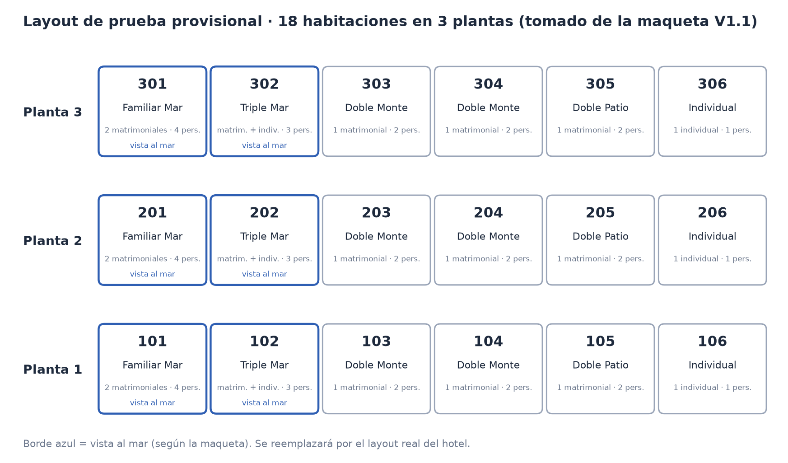
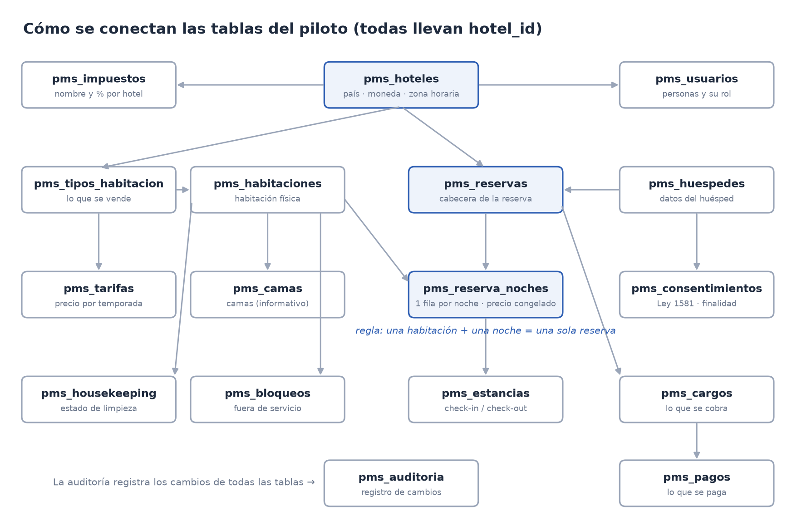
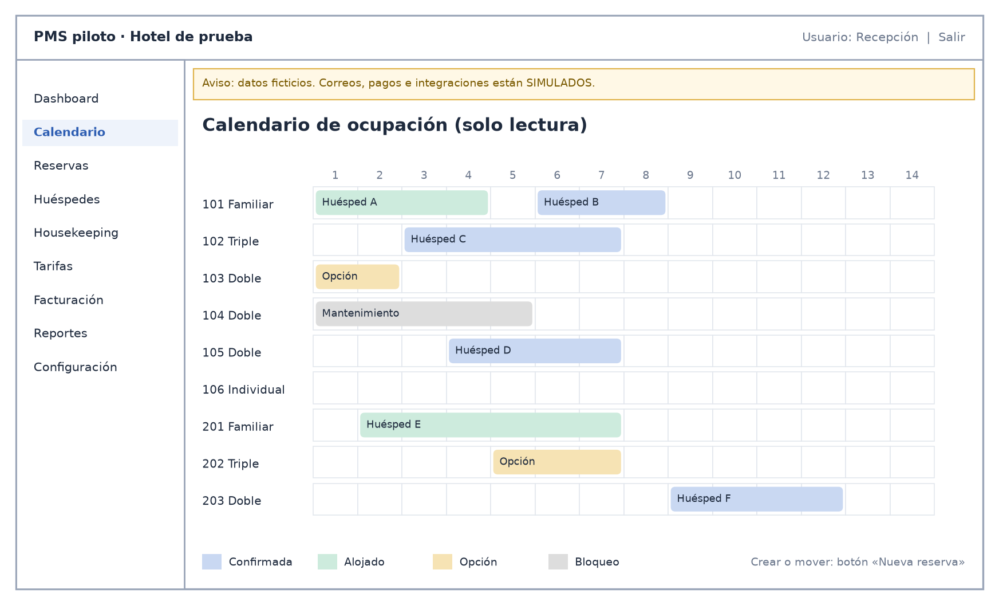
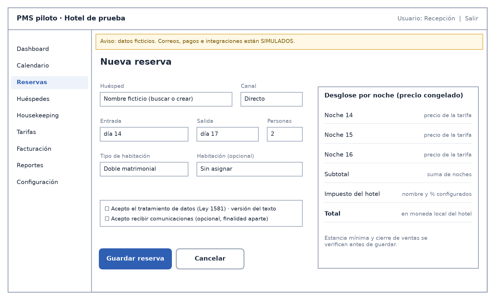
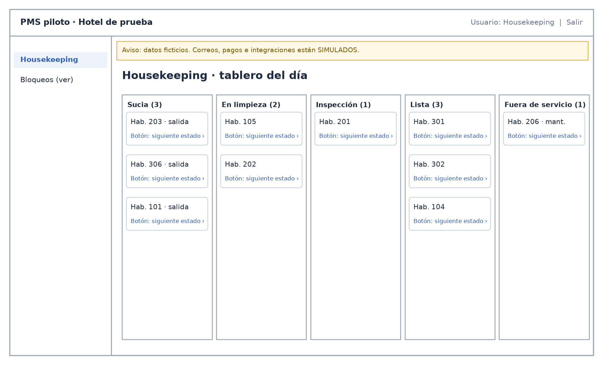
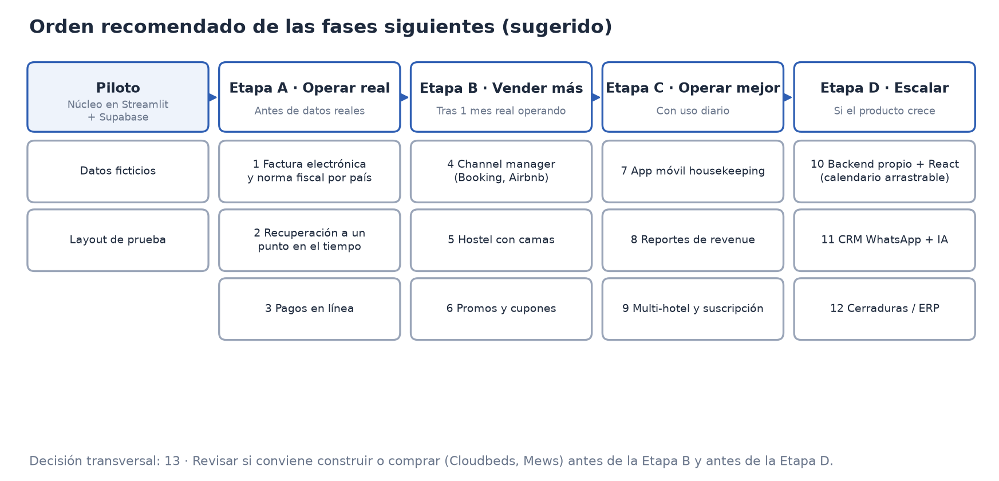

*Prototipo diseñado para ATm Consulting*

Documento de diseño

**Piloto de PMS hotelero**

Sistema de gestión de hoteles: reservas, habitaciones, limpieza y facturación simple

Prototipo diseñado para ATm Consulting

| **Dato** | **Valor** |
| --- | --- |
| **Versión** | 1.0 |
| **Estado** | Para aprobación (antes de construir) |
| **Fecha** | 28 de octubre de 2026 |
| **Preparado para** | ATm Consulting, Colombia |
| **Datos usados** | Solo datos ficticios. Ningún dato real de huéspedes. |
| **Fuentes** | Revisión de la planeación StayCore, Informe de planificación StayCore PMS, hoja de fases, manual de usuario y maqueta V1.1 |

*Cómo leer este documento: todo lo que no viene de las fuentes ni de una decisión del usuario está marcado como «Sugerido:». Toda cifra de costo o norma externa está marcada como «estimado a verificar».*

# 1. Resumen y objetivo del piloto

Este documento describe qué se va a construir en el piloto del PMS hotelero, para que puedas revisarlo y aprobarlo antes de empezar. Un PMS (sistema de gestión de propiedades) es el programa donde un hotel lleva sus reservas, sus habitaciones, la limpieza y el cobro de cada estancia.

**Objetivo.** El objetivo del piloto es tener una versión funcional y sencilla, con datos ficticios, que sirva para demostrar el flujo completo de un hotel: reservar, recibir al huésped, cobrar, limpiar la habitación y ver los resultados del día. No es todavía un sistema para operar un hotel real.

Herramientas del piloto (cada una explicada en una frase):

* **Streamlit:** la herramienta con la que se arma la aplicación web; se publica gratis en su servicio Community Cloud.
* **Supabase Free:** la base de datos en la nube (el lugar donde se guardan los datos) en su plan gratuito. Todas las tablas del piloto empiezan por pms\_ para distinguirlas.
* **GitHub:** un repositorio privado (una carpeta en la nube con el código y su historial de cambios), visible solo para quien tú autorices.

**Base de diseño.** Del informe previo StayCore se toman tres principios de diseño que conviene respetar desde el primer día porque son caros de cambiar después:

* Se vende el tipo de habitación; la habitación física concreta se asigna después, hasta el check-in.
* El precio de cada noche se congela al vender y nunca se recalcula.
* Lo que hay disponible (inventario) y lo que cuesta (tarifas) se guardan por separado.

**Enfoque.** La revisión previa recomienda no adoptar StayCore completo (es un producto de 12 meses de desarrollo con otro stack) y seguir con un piloto en Streamlit + Supabase que incorpore esas decisiones de diseño. La maqueta V1.1 se usa solo como inspiración visual.

# 2. Decisiones del usuario

Estas decisiones ya están tomadas y el diseño las respeta:

| **Tema** | **Decisión** | **Cómo se refleja en el piloto** |
| --- | --- | --- |
| **Países** | Sistema internacional. Ejemplos configurables: República Dominicana, Colombia y otros países. | Cada hotel tiene un campo «país». Los nombres de país son solo ejemplos: se puede agregar cualquier país sin cambiar el programa. |
| **Moneda** | Cada hotel trabaja con su moneda local. | Cada hotel guarda su moneda y todos sus precios, cargos, pagos y reportes se muestran en esa moneda. El piloto no convierte entre monedas. |
| **Impuestos** | Impuestos genéricos para este prototipo. | Cada hotel tiene uno o varios impuestos con nombre y porcentaje, que se configuran a mano. No se implementa la norma fiscal específica de ningún país. |
| **Colombia** | Por ahora también genérica, salvo lo que el usuario defina. | Colombia usa el mismo esquema genérico. La factura electrónica DIAN queda fuera del piloto y se propone para una fase posterior (sección 8). |
| **Habitaciones y camas** | Usar como prueba la configuración del layout entregado. | Se cargan las 18 habitaciones del plano de la maqueta V1.1 como layout de prueba provisional (sección 3.1). Se reemplazará por el layout real. |
| **Hoteles reales** | Existen; los datos llegan después. | El piloto arranca con un hotel de prueba ficticio. Los hoteles reales se cargan cuando envíes sus datos. |
| **Diseño visual** | La maqueta es inspiración; se prefieren fondos blancos. | Pantallas con fondo blanco, limpias, sin degradados ni fondos oscuros. |

Ejemplos de configuración por hotel (valores ilustrativos; los reales los defines tú):

| **Campo del hotel** | **Ejemplo para un hotel en Colombia** | **Ejemplo para un hotel en República Dominicana** |
| --- | --- | --- |
| **País** | Colombia | República Dominicana |
| **Moneda** | Peso colombiano (COP) | Peso dominicano (DOP) |
| **Zona horaria** | America/Bogota | America/Santo\_Domingo |
| **Impuesto (nombre y %)** | Lo defines tú al configurar el hotel | Lo defines tú al configurar el hotel |

# 3. Alcance del piloto (lo que sí entra)

Esta es la lista cerrada de funciones del piloto. Lo que no aparece aquí queda para las fases siguientes (sección 8).

| **Módulo** | **Qué hace en el piloto** |
| --- | --- |
| **Reservas** | Crear, modificar y cancelar reservas. Cada noche guarda su precio congelado. Estados: consulta → opción → confirmada → alojado → salida; más cancelada y no-show (no se presentó). Cada reserva guarda canal (por defecto «directo»), comisión, neto y una referencia externa única, aunque todo se registre a mano. |
| **Calendario y disponibilidad** | Rejilla de habitaciones por días con colores por estado. Es de solo lectura: las reservas se crean y cambian con formularios, porque Streamlit no permite arrastrar barras. |
| **Tarifas** | Precio por tipo de habitación y por temporada (rango de fechas), con estancia mínima (noches mínimas) y cierre de ventas (no vender esa fecha). |
| **Huéspedes y consentimientos** | Ficha del huésped con datos ficticios. Registro de consentimiento según la Ley 1581 de Colombia: uno por finalidad, con fecha, texto aceptado y versión. Otros países tienen sus propias leyes de protección de datos; el piloto no las implementa en detalle. |
| **Check-in y check-out** | Registro de llegada y salida de cada estancia. Al hacer check-out la habitación pasa sola a «sucia». |
| **Housekeeping (limpieza)** | Tablero con estados: sucia → en limpieza → inspección → lista, más fuera de servicio. |
| **Bloqueos por mantenimiento** | Marcar una habitación fuera de servicio por fechas y motivo; no se puede vender mientras dure. |
| **Facturación simple** | Cargos y pagos como líneas separadas (nunca un simple «pagado sí/no»). Impuestos genéricos del hotel. Comprobante en PDF, que no es una factura legal. |
| **Reportes** | Ocupación e ingresos por período. |
| **Dashboard del día** | Llegadas, salidas, ocupación e ingresos del día. |
| **Roles** | Recepción, gerencia y housekeeping, más un administrador del sistema (ver justificación abajo). |
| **Auditoría** | Registro de cambios importantes (quién, cuándo, valor anterior). Solo se agrega; no se edita ni se borra. |
| **Configuración** | Hoteles (país, moneda, zona horaria), impuestos, tipos de habitación, habitaciones, camas y usuarios. |

**Roles.** El informe previo define cuatro perfiles (recepción, housekeeping, revenue/comercial y dirección/admin). La revisión recomienda tres para el piloto: gerencia también hace de revenue/comercial y ese cuarto rol queda para el futuro.

* **Sugerido:** agregar un rol de administrador del sistema separado de gerencia, solo para configurar hoteles, impuestos, habitaciones y usuarios. Razón: quien opera y aprueba descuentos no debería poder cambiar también las reglas (impuestos, usuarios) sin dejar rastro. En el piloto puede ser la misma persona de ATm Consulting, pero el rol queda separado para cuando haya hoteles reales.

## 3.1 Configuración de habitaciones y camas (layout de prueba provisional)

Importante: las 18 habitaciones que siguen son un layout de prueba provisional, tomado del plano de la maqueta V1.1 (un hotel ficticio de ejemplo). Sirven solo para construir y probar el piloto. Se reemplazarán por el layout y los datos reales que enviarás.

Según la maqueta, el edificio tiene 3 plantas con 6 habitaciones cada una, y cada planta repite la misma distribución:

| **Habitación (por planta)** | **Tipo** | **Camas** | **Capacidad** | **Tamaño** | **Vista** |
| --- | --- | --- | --- | --- | --- |
| **x01** | Familiar Mar | 2 matrimoniales (150 cm) | 4 personas | 34 m² | Al mar |
| **x02** | Triple Mar | 1 matrimonial + 1 individual (90 cm) | 3 personas | 28 m² | Al mar |
| **x03 y x04** | Doble Monte | 1 matrimonial | 2 personas | 22 m² | Interior |
| **x05** | Doble Patio | 1 matrimonial | 2 personas | 22 m² | Interior |
| **x06** | Individual | 1 individual | 1 persona | 14 m² | Interior |

«x» es el número de planta: 101 a 106, 201 a 206 y 301 a 306. La rejilla de tarifas de la maqueta agrupa estas habitaciones en 4 tipos de venta: Familiar Mar (3), Triple Mar (3), Doble matrimonial (9, que junta Doble Monte y Doble Patio) e Individual (3).

*Imagen 1. Layout de prueba provisional: 18 habitaciones en 3 plantas, según la maqueta V1.1.*

**Cómo se modelan las camas.** La maqueta muestra habitaciones con una o dos camas y no incluye dormitorios compartidos tipo hostel en estas 18 habitaciones (el dormitorio «Dorm 8 Mix» aparece solo como ejemplo en el manual).

* **Sugerido:** en el piloto se vende la habitación completa (por tipo), y las camas se guardan solo como información de cada habitación: cuántas camas, de qué tipo y tamaño. Así recepción y housekeeping saben qué hay en cada habitación, sin complicar la disponibilidad. Vender cama por cama (modelo hostel) queda para una fase siguiente (sección 8). Esta es la opción más simple y no impide agregar el modelo hostel después, porque la tabla de camas ya existe.

# 4. Modelo de datos en lenguaje simple

Una tabla es como una hoja de cálculo: cada fila es un registro (por ejemplo, una reserva) y cada columna es un dato (por ejemplo, la fecha de entrada). Todas las tablas llevan el campo hotel\_id, que indica a qué hotel pertenece cada fila; así se pueden tener varios hoteles en la misma base de datos sin mezclar su información.

| **Tabla** | **Qué guarda (en una frase)** |
| --- | --- |
| **pms\_hoteles** | Cada hotel con su nombre, país, moneda y zona horaria. |
| **pms\_impuestos** | Los impuestos de cada hotel: nombre, porcentaje y si están activos. |
| **pms\_usuarios** | Las personas que usan el sistema y su rol (recepción, gerencia, housekeeping o administrador). |
| **pms\_tipos\_habitacion** | Lo que se vende: cada tipo (por ejemplo, Familiar Mar) con su capacidad. |
| **pms\_habitaciones** | Cada habitación física con su número, planta, tipo y estado. |
| **pms\_camas** | Las camas de cada habitación (tipo y tamaño), solo informativo en el piloto. |
| **pms\_tarifas** | El precio por noche de cada tipo por temporada, con estancia mínima y cierre de ventas. |
| **pms\_huespedes** | Los datos de cada huésped (ficticios en el piloto). |
| **pms\_consentimientos** | Cada autorización de datos del huésped: finalidad, fecha, texto aceptado y versión (Ley 1581). |
| **pms\_reservas** | La cabecera de la reserva: huésped, fechas, tipo, estado, canal, comisión, neto y referencia externa única. |
| **pms\_reserva\_noches** | Una fila por cada noche de la reserva, con su precio congelado y la habitación asignada. |
| **pms\_estancias** | El check-in y el check-out reales de cada reserva. |
| **pms\_housekeeping** | El estado de limpieza de cada habitación y sus cambios. |
| **pms\_bloqueos** | Las habitaciones fuera de servicio, con fechas y motivo. |
| **pms\_cargos** | Lo que se le cobra al huésped (noches, extras, impuestos), línea por línea. |
| **pms\_pagos** | Lo que el huésped paga (efectivo, datáfono, transferencia), línea por línea. |
| **pms\_auditoria** | El registro de cambios: quién hizo qué, cuándo y qué valor había antes. No se edita ni se borra. |

**Regla clave contra dobles ventas.** En pms\_reserva\_noches la base de datos no permite dos filas con la misma habitación y la misma noche. Así es imposible vender dos veces la misma habitación la misma noche, aunque dos personas lo intenten al mismo tiempo. La revisión previa la propone como una alternativa más sencilla que la solución avanzada del informe StayCore.

**Lo que se omite a propósito.** La revisión menciona una tabla opcional de inventario por día (pms\_inventario\_dia) solo si se necesitan reportes rápidos; con 18 habitaciones la disponibilidad se puede calcular desde las noches reservadas, así que no se incluye. Tampoco se incluye la tabla de eventos de salida («outbox») hasta que existan integraciones.

*Imagen 2. Diagrama sencillo de relaciones entre las tablas del piloto. Las flechas van de la tabla principal a la tabla que depende de ella.*

# 5. Pantallas y roles

Lista de pantallas del piloto y qué puede hacer cada rol. ✓ = puede usarla; Ver = solo consultar; — = no tiene acceso.

| **Pantalla** | **Para qué sirve** | **Recepción** | **Gerencia** | **Housekeeping** | **Admin.** |
| --- | --- | --- | --- | --- | --- |
| **Dashboard del día** | Llegadas, salidas, ocupación e ingresos de hoy | ✓ | ✓ | — | Ver |
| **Calendario** | Ver qué habitación está ocupada cada día | ✓ | ✓ | — | Ver |
| **Reservas** | Crear, cambiar, cancelar; check-in y check-out | ✓ (cancelar requiere gerencia) | ✓ (aprueba) | — | Ver |
| **Huéspedes** | Ficha y consentimientos | ✓ | ✓ | — | Ver |
| **Housekeeping** | Cambiar el estado de limpieza | Ver | ✓ | ✓ | Ver |
| **Bloqueos** | Poner una habitación fuera de servicio | Ver | ✓ | Ver | ✓ |
| **Tarifas** | Precios por temporada, estancia mínima, cierre | Ver | ✓ | — | ✓ |
| **Facturación** | Cargos, pagos y comprobante PDF | ✓ (descuentos requieren gerencia) | ✓ (aprueba) | — | Ver |
| **Reportes** | Ocupación e ingresos | — | ✓ | — | ✓ |
| **Configuración** | Hoteles, impuestos, habitaciones, camas, usuarios | — | Ver | — | ✓ |
| **Auditoría** | Ver el registro de cambios | — | ✓ | — | ✓ |

Las restricciones vienen del informe previo: housekeeping no ve precios ni datos de pago, y recepción no edita tarifas y tiene descuentos limitados. Las aprobaciones de descuentos y cancelaciones por gerencia son una decisión del usuario.

* **Sugerido:** la asignación exacta de «Ver» y «✓» de esta tabla es una propuesta; se puede ajustar al aprobar.

## 5.1 Esquemas de pantallas clave

Los esquemas siguientes (wireframes: dibujos simples de cómo se ordena cada pantalla, sin diseño final) muestran tres pantallas con fondo blanco. Los nombres y datos son ficticios.

*Imagen 3. Calendario de ocupación: rejilla de solo lectura con colores por estado. Las reservas se crean o mueven desde un formulario.*

*Imagen 4. Nueva reserva: datos, consentimiento y desglose por noche con el impuesto y la moneda del hotel.*

*Imagen 5. Housekeeping: tablero por estado; cada tarjeta avanza con un botón. El rol housekeeping no ve precios.*

**Aviso permanente.** Todas las pantallas muestran arriba un aviso visible de que los datos son ficticios y que correos, pagos e integraciones están simulados.

# 6. Plan gratuito, costo estimado y respaldo

**Qué cabe en el plan gratuito.** Según la revisión previa, el piloto cabe en los planes gratuitos: con 18 habitaciones y datos de prueba el espacio que se usa es mínimo.

* **Sugerido:** revisar los límites vigentes de Streamlit Community Cloud y Supabase Free antes de construir (estimado a verificar).

**Si pasa a producción.** Si el piloto pasa a operar un hotel real, el costo estimado es de unos US$25 a US$50 al mes por hotel: Supabase Pro, alrededor de US$25 al mes, más el hosting de la aplicación (el servicio donde vive publicada). Es un estimado a verificar con los precios vigentes de cada proveedor y no incluye channel manager, WhatsApp ni pasarela de pagos.

| **Concepto** | **Piloto** | **Producción (estimado a verificar)** |
| --- | --- | --- |
| **Base de datos (Supabase)** | Plan gratuito | Supabase Pro, alrededor de US$25/mes |
| **Aplicación publicada** | Streamlit Community Cloud (gratis) | Hosting: parte del total de US$25–50/mes |
| **Repositorio de código (GitHub)** | Repositorio privado | Repositorio privado |
| **Channel manager (fase siguiente)** | No aplica | Alrededor de US$130/mes por propiedad, según el informe previo |

**Respaldo.** Copia de seguridad cifrada (protegida con clave) de la base de datos, hecha automáticamente con GitHub Actions (tareas programadas que corren en GitHub). Es una alternativa más modesta que la «recuperación a un punto en el tiempo» que pide el informe previo; según la revisión, el plan gratuito de Supabase no la ofrece como tal (estimado a verificar). El informe recuerda que una copia que nunca se ha restaurado no es una copia de seguridad.

* **Sugerido:** hacer una prueba de restauración de la copia al menos una vez durante el piloto.

# 7. Riesgos y avisos

| **Riesgo** | **Qué hacemos en el piloto** |
| --- | --- |
| **Correos e integraciones simulados** | Se avisa en pantalla, de forma visible y permanente, que correos, pagos e integraciones son simulados. La maqueta V1.1 muestra integraciones como «Conectado» que no existen y cifras inventadas; no se repite ese error. |
| **Sesión persistente** | La sesión del usuario debe mantenerse al recargar la página, para que recepción no pierda lo que estaba haciendo. |
| **Login de demostración** | El acceso de demostración (usuario de prueba) existe solo en el piloto y no queda abierto en producción. |
| **Separación de funciones** | Descuentos y cancelaciones los aprueba gerencia; quien registra no es quien aprueba. Todo queda en la auditoría. |
| **Datos personales** | Solo datos ficticios. El informe previo pide cifrar documentos de identidad, registrar cada consulta de datos personales y borrado automático; eso es más de lo que un piloto gratuito debe prometer. |
| **Comprobante no es factura** | El comprobante PDF no es factura legal. El piloto no emite factura electrónica DIAN ni de otro país. |
| **Calendario sin arrastre** | Streamlit no permite arrastrar reservas; el calendario es de solo lectura y se edita con formularios. |
| **Construir o comprar** | El propio informe previo recomienda evaluar seriamente si conviene construir, porque existen productos maduros (Cloudbeds, Mews, QloApps). Para un piloto de demostración está bien, pero la decisión debe revisarse antes de operar real. |

# 8. Fases siguientes

Para cada elemento que queda fuera del piloto se explica qué es, por qué no entra ahora y cuándo conviene abordarlo. El informe previo sigue esta lógica: primero un núcleo con cobro manual, luego pagos y después la conexión con agencias en línea, con una regla de corte: no pasar a la siguiente fase hasta que un hotel real haya operado un mes completo con la anterior.

* **Sugerido:** el orden de esta sección (etapas A a D y numeración 1 a 12) es una propuesta propia basada en esa lógica. Primero va lo que se necesita para operar con datos reales y dentro de la ley; luego lo que trae más ventas; después lo que mejora la operación diaria; y al final lo que solo conviene si el producto crece.

*Imagen 6. Orden recomendado de las fases siguientes (sugerido).*

### Etapa A · Antes de operar con datos reales

| **#** | **Qué es** | **Por qué queda fuera ahora** | **Cuándo conviene** |
| --- | --- | --- | --- |
| 1 | Factura electrónica y normativa fiscal por país: emitir facturas legales y aplicar las reglas de impuestos de cada país (por ejemplo, DIAN en Colombia y DGII en República Dominicana). La revisión menciona también, como observación por verificar con asesoría, el registro de huéspedes extranjeros ante Migración Colombia y el Registro Nacional de Turismo. | Cada país tiene reglas propias que cambian; el usuario pidió impuestos genéricos para el prototipo. Requiere asesoría fiscal y un proveedor autorizado (estimado a verificar). | Antes de cobrar a huéspedes reales en cada país. Verificar las normas vigentes de DIAN y DGII antes de diseñar (estimado a verificar). |
| 2 | Recuperación a un punto en el tiempo: poder devolver la base de datos al estado exacto de un momento (por ejemplo, ayer a las 3:15 p. m.). | El piloto solo tiene datos ficticios; el respaldo cifrado con GitHub Actions basta. Según la revisión, el plan gratuito no la ofrece como tal (estimado a verificar). | **Sugerido:** en cuanto entren datos reales de un hotel, porque perder reservas reales es muy costoso. |
| 3 | Pagos en línea: cobrar con tarjeta, enlaces de pago o depósitos mediante una pasarela. El informe menciona Wompi y Mercado Pago para Colombia y Latinoamérica. | El informe la pone en su fase 2 (meses 4 a 7). Exige decidir antes, con asesoría legal, quién recibe el dinero; la tarjeta nunca debe entrar al sistema, solo un token (código de reemplazo). | Cuando el núcleo esté probado con un hotel real. Desbloquea prepago, garantía de reserva y cierre de caja sin hojas de cálculo. |

### Etapa B · Vender más

| **#** | **Qué es** | **Por qué queda fuera ahora** | **Cuándo conviene** |
| --- | --- | --- | --- |
| 4 | Conexión con Booking, Airbnb y otras agencias en línea a través de un channel manager externo (un servicio intermedio que publica disponibilidad y precios en todas las agencias a la vez). | Costo de alrededor de US$130/mes por propiedad según el informe (estimado a verificar). Airbnb no tiene API pública abierta. Conectar canales sobre un inventario no probado multiplica los errores. | El informe la pone en su fase 3 (meses 7 a 12), después de pagos y con al menos un mes de operación real. El piloto ya deja preparados canal, comisión y referencia externa. |
| 5 | Hostel con camas como unidad vendible: vender cama por cama en dormitorios compartidos. | El layout de prueba no tiene dormitorios compartidos; vender camas complica la disponibilidad. La tabla de camas ya existe como información. | Si alguno de los hoteles reales tiene dormitorios compartidos. El informe recomienda los hostels como mercado inicial de StayCore. |
| 6 | Promociones y cupones: descuentos por anticipación, última hora, estancias largas o códigos. | El informe exige un simulador antes de activar cualquier promoción, porque un descuento mal acotado puede aplicarse a toda una temporada. | Cuando haya historial de ventas real para medir qué campaña funciona. |

### Etapa C · Operar mejor

| **#** | **Qué es** | **Por qué queda fuera ahora** | **Cuándo conviene** |
| --- | --- | --- | --- |
| 7 | App móvil para housekeeping: el personal de limpieza cambia estados y reporta averías con foto desde el celular. | En el piloto el tablero funciona en el navegador; una app aparte es otro desarrollo. | **Sugerido:** cuando un hotel real use el tablero a diario y se vea qué le falta en el celular. |
| 8 | Reportes de revenue: indicadores como ADR (precio medio por noche vendida), RevPAR (ingreso por habitación disponible), ritmo de reservas y producción por canal. | Necesitan datos reales y varios canales para tener sentido. | Después de conectar canales y tener meses de historial. |
| 9 | Multi-hotel y multi-cliente completo con suscripción: que varios clientes usen el mismo sistema, cada uno viendo solo sus datos, y pagando una cuota. | Requiere aislamiento estricto de datos entre clientes y cobro recurrente. El piloto ya guarda hotel\_id en todas las tablas para no rehacer nada. | Si ATm Consulting decide vender el sistema a varios hoteles. |

### Etapa D · Escalar

| **#** | **Qué es** | **Por qué queda fuera ahora** | **Cuándo conviene** |
| --- | --- | --- | --- |
| 10 | Migración a backend propio + React: pasar de Streamlit a un servidor propio y una interfaz web moderna. Esto permite el calendario arrastrable (mover reservas con el ratón), que Streamlit no soporta. | Es lo que propone el informe StayCore (React y un backend tipo NestJS, Django, .NET o Go), con un esfuerzo mucho mayor que el piloto. | Cuando el producto esté validado y el número de hoteles o usuarios justifique la inversión. |
| 11 | CRM con WhatsApp e IA: bandeja única de conversaciones con huéspedes y un asistente que sugiere respuestas. | Tiene costo por mensaje y reglas que cambian con frecuencia; exige cuidar qué datos se envían al proveedor de IA (estimado a verificar). | Cuando haya volumen de huéspedes reales que lo justifique. |
| 12 | Cerraduras inteligentes y ERP (software contable): códigos de acceso por estancia y envío de facturas y cobros a la contabilidad. | Dependen de proveedores concretos de cada hotel y de tener facturación legal y pagos. | Después de la facturación electrónica y los pagos en línea. |

### Decisión transversal · Construir o comprar

**13.** El informe previo recomienda evaluar seriamente si conviene construir, porque ya existen productos maduros como Cloudbeds y Mews (y QloApps como opción de código abierto). Construir solo se justifica si el objetivo es un producto propio con un nicho y una propuesta diferente.

* **Sugerido:** hacer esta revisión dos veces: al terminar el piloto, antes de invertir en la etapa B, y antes de la migración de la etapa D, comparando el costo mensual de esos productos (estimado a verificar) con el costo de seguir desarrollando.

# 9. Lo que necesito de ti

| **Necesito** | **Para qué** |
| --- | --- |
| El layout real de cada hotel: habitaciones, tipos, camas (tipo y tamaño) y capacidad. | Reemplazar el layout de prueba provisional de 18 habitaciones. |
| Los datos de cada hotel: nombre, país, moneda local y zona horaria. | Configurar cada hotel con su moneda y su hora local. |
| Los impuestos de cada hotel: nombre y porcentaje. | Configurar los impuestos genéricos de cada país. |
| Si en Colombia quieres algo específico más allá de lo genérico. | Saber si algo de la norma colombiana debe entrar ya o en la fase 1 de la sección 8. |
| Tu aprobación de este documento (o tus cambios). | Empezar a construir el piloto. |