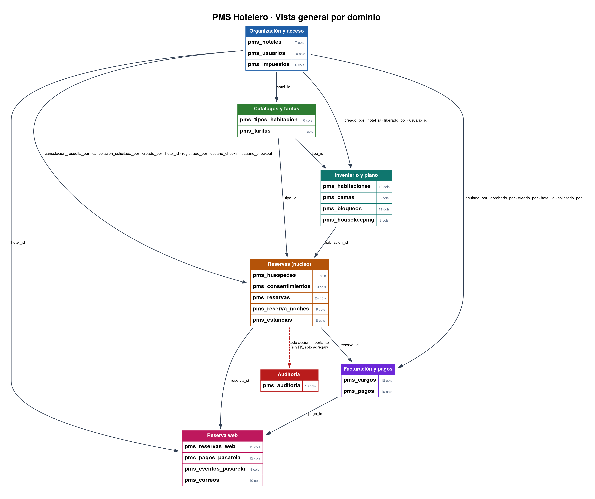
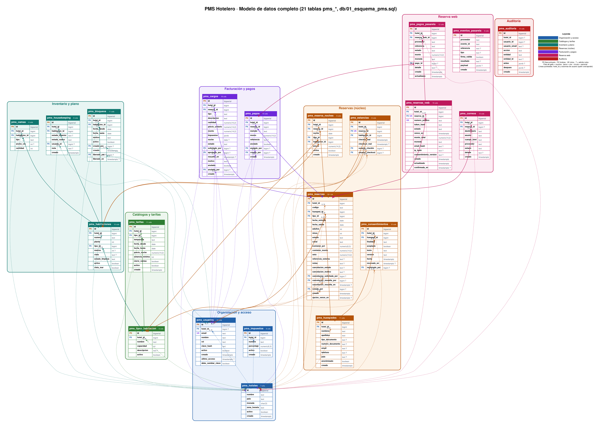
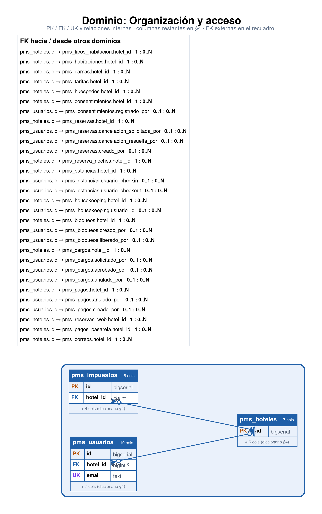
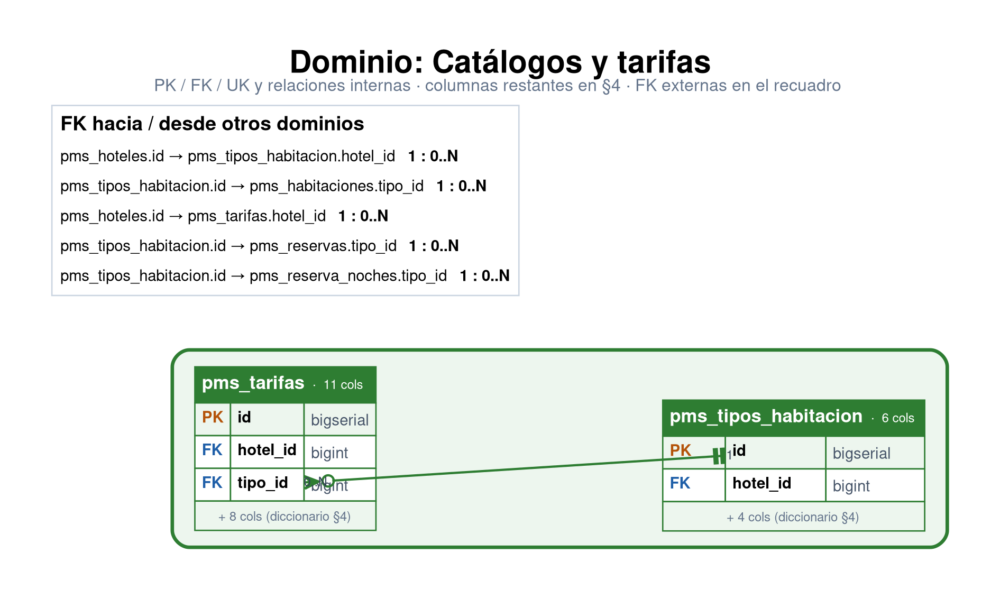
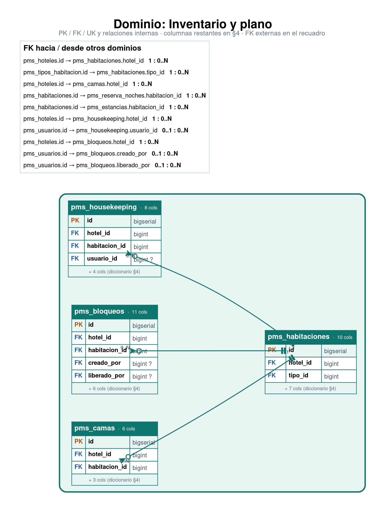
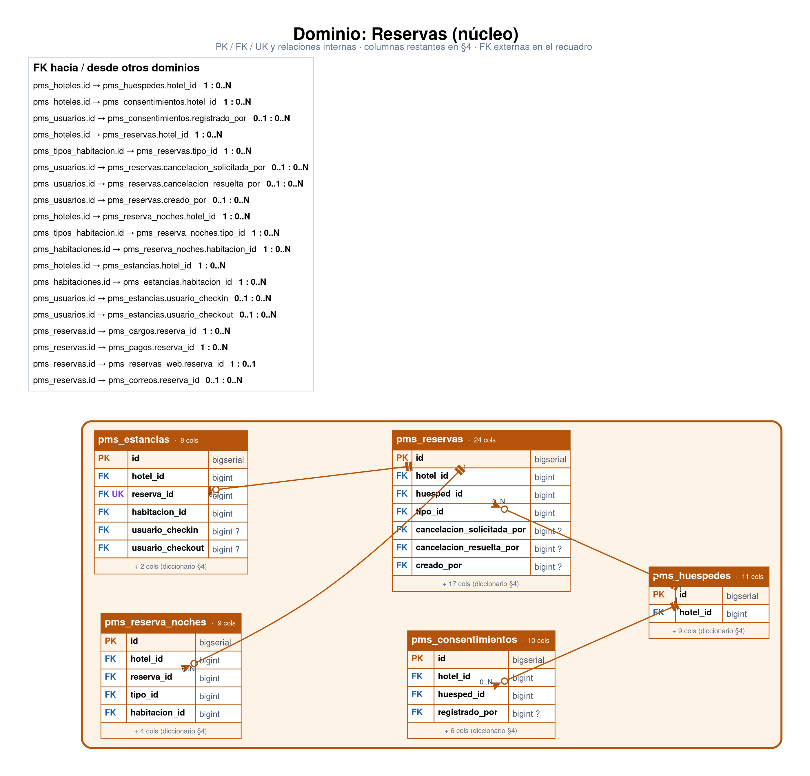
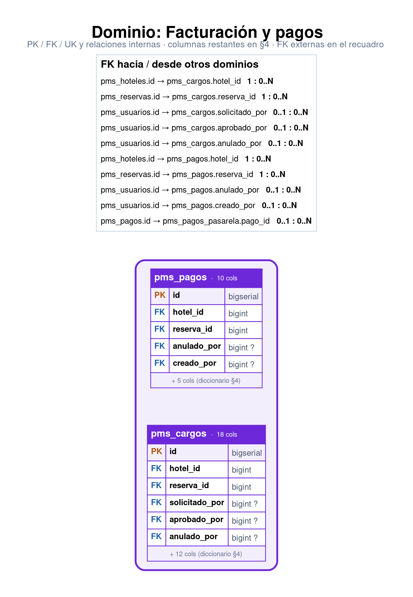
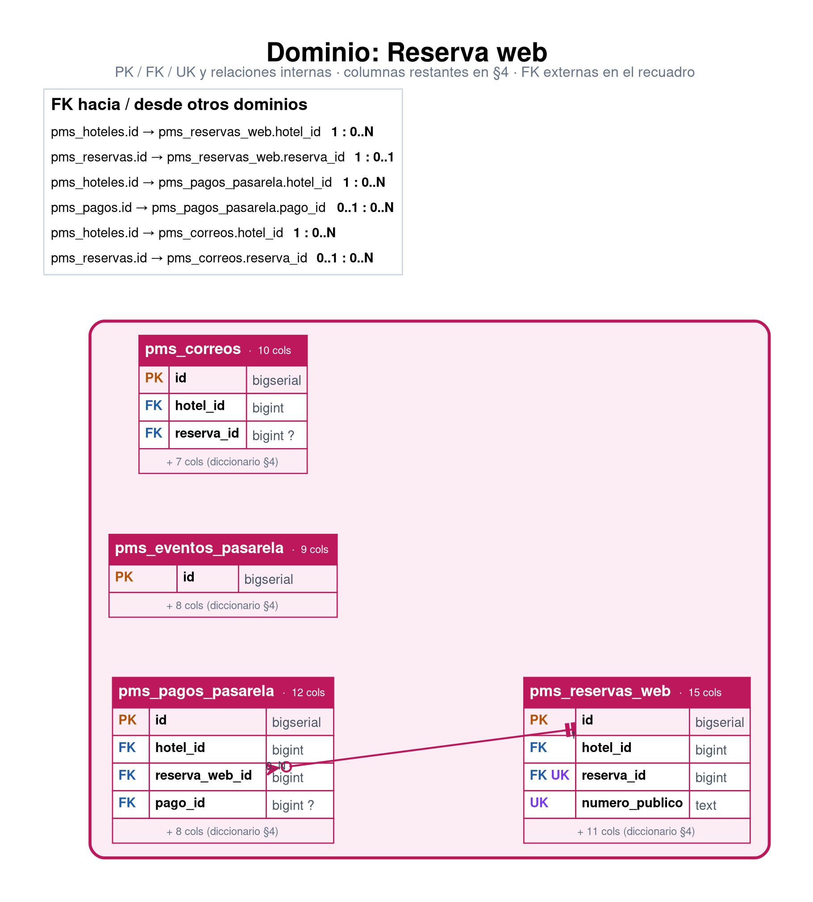
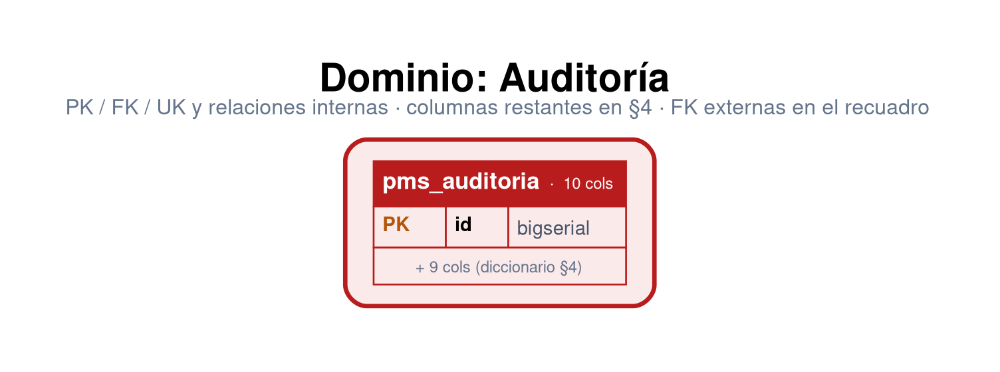
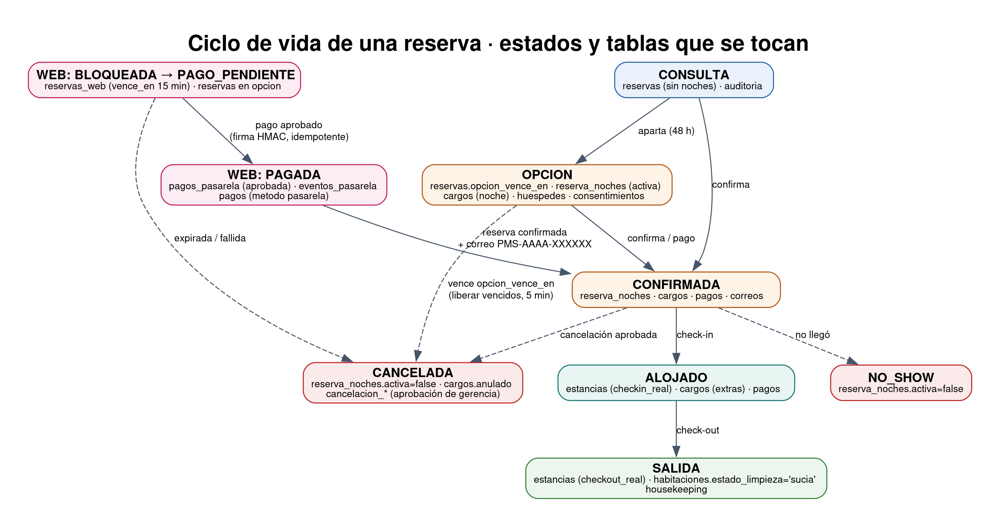

# PMS Hotelero · Piloto — Anexo A · Modelo de datos

*Prototipo diseñado para ATm Consulting · versión 1.1 · 29 de octubre de 2026 · fuente: `db/01_esquema_pms.sql` y `db/02_rls_pms.sql`*

## 1. Vista general por dominio
21 tablas con prefijo `pms_` en el esquema `public` de Supabase (proyecto *atlas-selleragent*), agrupadas en 7 dominios con un color cada uno. Las flechas van del dominio referenciado al que lo usa y llevan los nombres de las columnas FK. `pms_auditoria` no tiene FK: recibe una fila por cada acción importante.

## 2. Diagrama ER completo
Todas las tablas y columnas, agrupadas por dominio. Notación pata de gallo: **pata** = muchos, **barra** = uno, **círculo** = opcional; `?` = la columna admite nulos. Las líneas punteadas finas son `hotel_id` y las columnas de usuario (quién creó/aprobó), para no tapar las relaciones de negocio.

## 3. Diagramas por dominio
Cada diagrama muestra solo las columnas PK/FK/UK (el resto está en §4), las relaciones internas con su cardinalidad y un recuadro con las FK hacia o desde otros dominios.

### 3.1 Organización y acceso
Tablas: `pms_hoteles`, `pms_usuarios`, `pms_impuestos`.

### 3.2 Catálogos y tarifas
Tablas: `pms_tipos_habitacion`, `pms_tarifas`.

### 3.3 Inventario y plano
Tablas: `pms_habitaciones`, `pms_camas`, `pms_bloqueos`, `pms_housekeeping`.

### 3.4 Reservas (núcleo)
Tablas: `pms_huespedes`, `pms_consentimientos`, `pms_reservas`, `pms_reserva_noches`, `pms_estancias`.

### 3.5 Facturación y pagos
Tablas: `pms_cargos`, `pms_pagos`.

### 3.6 Reserva web
Tablas: `pms_reservas_web`, `pms_pagos_pasarela`, `pms_eventos_pasarela`, `pms_correos`.

### 3.7 Auditoría
Tablas: `pms_auditoria`.

## 4. Diccionario de datos
### pms_hoteles

| Columna | Tipo | Llave |
|---|---|---|
| `id` | bigserial | PK |
| `nombre` | text |  |
| `pais` | text |  |
| `moneda` | char |  |
| `zona_horaria` | text |  |
| `activo` | boolean |  |
| `creado` | timestamptz |  |

### pms_impuestos

| Columna | Tipo | Llave |
|---|---|---|
| `id` | bigserial | PK |
| `hotel_id` | bigint | FK |
| `nombre` | text |  |
| `porcentaje` | numeric |  |
| `activo` | boolean |  |
| `creado` | timestamptz |  |

### pms_usuarios

| Columna | Tipo | Llave |
|---|---|---|
| `id` | bigserial | PK |
| `hotel_id` | bigint | FK |
| `email` | text |  |
| `nombre` | text |  |
| `rol` | text |  |
| `clave_hash` | text |  |
| `activo` | boolean |  |
| `creado` | timestamptz |  |
| `ultimo_acceso` | timestamptz |  |
| `debe_cambiar_clave` | boolean |  |

### pms_tipos_habitacion

| Columna | Tipo | Llave |
|---|---|---|
| `id` | bigserial | PK |
| `hotel_id` | bigint | FK |
| `nombre` | text |  |
| `capacidad` | int |  |
| `descripcion` | text |  |
| `activo` | boolean |  |

### pms_habitaciones

| Columna | Tipo | Llave |
|---|---|---|
| `id` | bigserial | PK |
| `hotel_id` | bigint | FK |
| `numero` | text |  |
| `planta` | int |  |
| `tipo_id` | bigint | FK |
| `metros` | int |  |
| `vista` | text |  |
| `estado_limpieza` | text |  |
| `activo` | boolean |  |
| `vista_mar` | boolean |  |

### pms_camas

| Columna | Tipo | Llave |
|---|---|---|
| `id` | bigserial | PK |
| `hotel_id` | bigint | FK |
| `habitacion_id` | bigint | FK |
| `tipo` | text |  |
| `ancho_cm` | int |  |
| `cantidad` | int |  |

### pms_tarifas

| Columna | Tipo | Llave |
|---|---|---|
| `id` | bigserial | PK |
| `hotel_id` | bigint | FK |
| `tipo_id` | bigint | FK |
| `temporada` | text |  |
| `fecha_desde` | date |  |
| `fecha_hasta` | date |  |
| `precio_noche` | numeric |  |
| `estancia_minima` | int |  |
| `cierre_ventas` | boolean |  |
| `activo` | boolean |  |
| `creado` | timestamptz |  |

### pms_huespedes

| Columna | Tipo | Llave |
|---|---|---|
| `id` | bigserial | PK |
| `hotel_id` | bigint | FK |
| `nombres` | text |  |
| `apellidos` | text |  |
| `tipo_documento` | text |  |
| `numero_documento` | text |  |
| `email` | text |  |
| `telefono` | text |  |
| `pais` | text |  |
| `anonimizado` | boolean |  |
| `creado` | timestamptz |  |

### pms_consentimientos

| Columna | Tipo | Llave |
|---|---|---|
| `id` | bigserial | PK |
| `hotel_id` | bigint | FK |
| `huesped_id` | bigint | FK |
| `finalidad` | text |  |
| `aceptado` | boolean |  |
| `texto` | text |  |
| `version` | text |  |
| `fecha` | timestamptz |  |
| `revocado_en` | timestamptz |  |
| `registrado_por` | bigint | FK |

### pms_reservas

| Columna | Tipo | Llave |
|---|---|---|
| `id` | bigserial | PK |
| `hotel_id` | bigint | FK |
| `codigo` | text |  |
| `huesped_id` | bigint | FK |
| `tipo_id` | bigint | FK |
| `fecha_entrada` | date |  |
| `fecha_salida` | date |  |
| `adultos` | int |  |
| `ninos` | int |  |
| `estado` | text |  |
| `canal` | text |  |
| `comision_pct` | numeric |  |
| `comision_monto` | numeric |  |
| `neto` | numeric |  |
| `referencia_externa` | text |  |
| `notas` | text |  |
| `cancelacion_estado` | text |  |
| `cancelacion_motivo` | text |  |
| `cancelacion_solicitada_por` | bigint | FK |
| `cancelacion_resuelta_por` | bigint | FK |
| `cancelacion_resuelta_en` | timestamptz |  |
| `creado_por` | bigint | FK |
| `creado` | timestamptz |  |
| `opcion_vence_en` | timestamptz |  |

### pms_reserva_noches

| Columna | Tipo | Llave |
|---|---|---|
| `id` | bigserial | PK |
| `hotel_id` | bigint | FK |
| `reserva_id` | bigint | FK |
| `noche` | date |  |
| `tipo_id` | bigint | FK |
| `habitacion_id` | bigint | FK |
| `precio` | numeric |  |
| `activa` | boolean |  |
| `creado` | timestamptz |  |

### pms_estancias

| Columna | Tipo | Llave |
|---|---|---|
| `id` | bigserial | PK |
| `hotel_id` | bigint | FK |
| `reserva_id` | bigint | FK |
| `habitacion_id` | bigint | FK |
| `checkin_real` | timestamptz |  |
| `checkout_real` | timestamptz |  |
| `usuario_checkin` | bigint | FK |
| `usuario_checkout` | bigint | FK |

### pms_housekeeping

| Columna | Tipo | Llave |
|---|---|---|
| `id` | bigserial | PK |
| `hotel_id` | bigint | FK |
| `habitacion_id` | bigint | FK |
| `estado_anterior` | text |  |
| `estado_nuevo` | text |  |
| `usuario_id` | bigint | FK |
| `nota` | text |  |
| `creado` | timestamptz |  |

### pms_bloqueos

| Columna | Tipo | Llave |
|---|---|---|
| `id` | bigserial | PK |
| `hotel_id` | bigint | FK |
| `habitacion_id` | bigint | FK |
| `fecha_desde` | date |  |
| `fecha_hasta` | date |  |
| `motivo` | text |  |
| `activo` | boolean |  |
| `creado_por` | bigint | FK |
| `creado` | timestamptz |  |
| `liberado_por` | bigint | FK |
| `liberado_en` | timestamptz |  |

### pms_cargos

| Columna | Tipo | Llave |
|---|---|---|
| `id` | bigserial | PK |
| `hotel_id` | bigint | FK |
| `reserva_id` | bigint | FK |
| `tipo` | text |  |
| `descripcion` | text |  |
| `cantidad` | numeric |  |
| `precio_unitario` | numeric |  |
| `monto` | numeric |  |
| `impuestos` | jsonb |  |
| `noche` | date |  |
| `estado` | text |  |
| `solicitado_por` | bigint | FK |
| `aprobado_por` | bigint | FK |
| `resuelto_en` | timestamptz |  |
| `motivo` | text |  |
| `anulado` | boolean |  |
| `anulado_por` | bigint | FK |
| `creado` | timestamptz |  |

### pms_pagos

| Columna | Tipo | Llave |
|---|---|---|
| `id` | bigserial | PK |
| `hotel_id` | bigint | FK |
| `reserva_id` | bigint | FK |
| `metodo` | text |  |
| `monto` | numeric |  |
| `referencia` | text |  |
| `anulado` | boolean |  |
| `anulado_por` | bigint | FK |
| `creado_por` | bigint | FK |
| `creado` | timestamptz |  |

### pms_auditoria

| Columna | Tipo | Llave |
|---|---|---|
| `id` | bigserial | PK |
| `hotel_id` | bigint |  |
| `usuario_id` | bigint |  |
| `usuario_email` | text |  |
| `accion` | text |  |
| `entidad` | text |  |
| `entidad_id` | text |  |
| `antes` | jsonb |  |
| `despues` | jsonb |  |
| `creado` | timestamptz |  |

### pms_reservas_web

| Columna | Tipo | Llave |
|---|---|---|
| `id` | bigserial | PK |
| `hotel_id` | bigint | FK |
| `reserva_id` | bigint | FK |
| `numero_publico` | text |  |
| `token_hash` | text |  |
| `estado` | text |  |
| `vence_en` | timestamptz |  |
| `monto_total` | numeric |  |
| `moneda` | text |  |
| `email_hash` | text |  |
| `ip_hash` | text |  |
| `consentimiento_version` | text |  |
| `creado` | timestamptz |  |
| `actualizado` | timestamptz |  |
| `confirmada_en` | timestamptz |  |

### pms_pagos_pasarela

| Columna | Tipo | Llave |
|---|---|---|
| `id` | bigserial | PK |
| `hotel_id` | bigint | FK |
| `reserva_web_id` | bigint | FK |
| `proveedor` | text |  |
| `referencia` | text |  |
| `estado` | text |  |
| `monto` | numeric |  |
| `moneda` | text |  |
| `pago_id` | bigint | FK |
| `detalle` | text |  |
| `creado` | timestamptz |  |
| `actualizado` | timestamptz |  |

### pms_eventos_pasarela

| Columna | Tipo | Llave |
|---|---|---|
| `id` | bigserial | PK |
| `proveedor` | text |  |
| `evento_id` | text |  |
| `referencia` | text |  |
| `tipo` | text |  |
| `firma_valida` | boolean |  |
| `resultado` | text |  |
| `payload` | jsonb |  |
| `creado` | timestamptz |  |

### pms_correos

| Columna | Tipo | Llave |
|---|---|---|
| `id` | bigserial | PK |
| `hotel_id` | bigint | FK |
| `reserva_id` | bigint | FK |
| `destinatario` | text |  |
| `asunto` | text |  |
| `cuerpo_html` | text |  |
| `proveedor` | text |  |
| `estado` | text |  |
| `detalle` | text |  |
| `creado` | timestamptz |  |

## 5. Tabla de relaciones
| Tabla | Columna | Referencia a | Cardinalidad |
|---|---|---|---|
| pms_impuestos | `hotel_id` | pms_hoteles(id) | N a 1 |
| pms_usuarios | `hotel_id` | pms_hoteles(id) | N a 1 |
| pms_tipos_habitacion | `hotel_id` | pms_hoteles(id) | N a 1 |
| pms_habitaciones | `hotel_id` | pms_hoteles(id) | N a 1 |
| pms_habitaciones | `tipo_id` | pms_tipos_habitacion(id) | N a 1 |
| pms_camas | `hotel_id` | pms_hoteles(id) | N a 1 |
| pms_camas | `habitacion_id` | pms_habitaciones(id) | N a 1 |
| pms_tarifas | `hotel_id` | pms_hoteles(id) | N a 1 |
| pms_tarifas | `tipo_id` | pms_tipos_habitacion(id) | N a 1 |
| pms_huespedes | `hotel_id` | pms_hoteles(id) | N a 1 |
| pms_consentimientos | `hotel_id` | pms_hoteles(id) | N a 1 |
| pms_consentimientos | `huesped_id` | pms_huespedes(id) | N a 1 |
| pms_consentimientos | `registrado_por` | pms_usuarios(id) | N a 1 |
| pms_reservas | `hotel_id` | pms_hoteles(id) | N a 1 |
| pms_reservas | `huesped_id` | pms_huespedes(id) | N a 1 |
| pms_reservas | `tipo_id` | pms_tipos_habitacion(id) | N a 1 |
| pms_reservas | `cancelacion_solicitada_por` | pms_usuarios(id) | N a 1 |
| pms_reservas | `cancelacion_resuelta_por` | pms_usuarios(id) | N a 1 |
| pms_reservas | `creado_por` | pms_usuarios(id) | N a 1 |
| pms_reserva_noches | `hotel_id` | pms_hoteles(id) | N a 1 |
| pms_reserva_noches | `reserva_id` | pms_reservas(id) | N a 1 |
| pms_reserva_noches | `tipo_id` | pms_tipos_habitacion(id) | N a 1 |
| pms_reserva_noches | `habitacion_id` | pms_habitaciones(id) | N a 1 |
| pms_estancias | `hotel_id` | pms_hoteles(id) | N a 1 |
| pms_estancias | `reserva_id` | pms_reservas(id) | 1 a 1 |
| pms_estancias | `habitacion_id` | pms_habitaciones(id) | N a 1 |
| pms_estancias | `usuario_checkin` | pms_usuarios(id) | N a 1 |
| pms_estancias | `usuario_checkout` | pms_usuarios(id) | N a 1 |
| pms_housekeeping | `hotel_id` | pms_hoteles(id) | N a 1 |
| pms_housekeeping | `habitacion_id` | pms_habitaciones(id) | N a 1 |
| pms_housekeeping | `usuario_id` | pms_usuarios(id) | N a 1 |
| pms_bloqueos | `hotel_id` | pms_hoteles(id) | N a 1 |
| pms_bloqueos | `habitacion_id` | pms_habitaciones(id) | N a 1 |
| pms_bloqueos | `creado_por` | pms_usuarios(id) | N a 1 |
| pms_bloqueos | `liberado_por` | pms_usuarios(id) | N a 1 |
| pms_cargos | `hotel_id` | pms_hoteles(id) | N a 1 |
| pms_cargos | `reserva_id` | pms_reservas(id) | N a 1 |
| pms_cargos | `solicitado_por` | pms_usuarios(id) | N a 1 |
| pms_cargos | `aprobado_por` | pms_usuarios(id) | N a 1 |
| pms_cargos | `anulado_por` | pms_usuarios(id) | N a 1 |
| pms_pagos | `hotel_id` | pms_hoteles(id) | N a 1 |
| pms_pagos | `reserva_id` | pms_reservas(id) | N a 1 |
| pms_pagos | `anulado_por` | pms_usuarios(id) | N a 1 |
| pms_pagos | `creado_por` | pms_usuarios(id) | N a 1 |
| pms_reservas_web | `hotel_id` | pms_hoteles(id) | N a 1 |
| pms_reservas_web | `reserva_id` | pms_reservas(id) | 1 a 1 |
| pms_pagos_pasarela | `hotel_id` | pms_hoteles(id) | N a 1 |
| pms_pagos_pasarela | `reserva_web_id` | pms_reservas_web(id) | N a 1 |
| pms_pagos_pasarela | `pago_id` | pms_pagos(id) | N a 1 |
| pms_correos | `hotel_id` | pms_hoteles(id) | N a 1 |
| pms_correos | `reserva_id` | pms_reservas(id) | N a 1 |

ON DELETE: no se definió acción (restringe el borrado de filas referenciadas).

## 6. Cómo fluye una reserva por las tablas

1. **Huésped:** `pms_huespedes` + `pms_consentimientos` (finalidad, versión del texto, fecha).
2. **Reserva:** `pms_reservas` (estado, canal, personas, fechas; `opcion_vence_en` si es opción) y una fila de `pms_reserva_noches` por noche con habitación y **precio congelado**.
3. **Cuenta:** `pms_cargos` (noches, extras, descuentos con aprobación e impuestos congelados en jsonb) y `pms_pagos`.
4. **Check-in/out:** `pms_estancias`; el check-out deja la habitación `sucia` y se registra en `pms_housekeeping`.
5. **Cancelación / no-show:** las noches pasan a `activa = false` y la habitación queda libre.
6. **Reserva web:** `pms_reservas_web` (número público, hash del token, estado, vencimiento) → `pms_pagos_pasarela` → `pms_eventos_pasarela` (idempotencia) → `pms_pagos` (método `pasarela`) → `pms_correos`.
7. Toda acción importante queda en `pms_auditoria`.

### 6.1 Reglas de integridad
- `ux_pms_noche_habitacion` (habitacion_id, noche) **where activa**: sin doble venta.
- `ux_pms_noche_reserva` (reserva_id, noche) where activa.
- `ux_pms_reservas_ref_externa` (hotel_id, canal, referencia_externa): evita duplicar reservas de canales.
- Checks: fechas de salida > entrada, porcentajes 0–100, montos ≥ 0, estados en listas cerradas.

### 6.2 Índices
`ix_pms_reservas_fechas`, `ix_pms_reservas_opcion_vence`, `ix_pms_noches_hotel`, `ix_pms_hk_hab`, `ix_pms_cargos_reserva`, `ix_pms_pagos_reserva`, `ix_pms_aud_hotel`, `ix_pms_rweb_hotel`, `ix_pms_rweb_ip`, `ix_pms_pasarela_rweb`, `ix_pms_correos_reserva`.

### 6.3 Funciones y triggers
`pms_auditoria_inmutable()` con el trigger `pms_auditoria_no_update` (before update or delete): la auditoría es de solo agregar.

### 6.4 RLS
`db/02_rls_pms.sql` activa RLS en todas las tablas `pms_*` **sin políticas** y revoca todo a `anon` y `authenticated` (tablas y secuencias). Resultado: la API REST pública de Supabase no devuelve nada; solo el servidor de las apps accede con `DATABASE_URL`.

### 6.5 Migraciones
El esquema es idempotente (`create … if not exists`, `alter … add column if not exists`): `debe_cambiar_clave`, `vista_mar`, `opcion_vence_en` y el método de pago `pasarela` se agregaron sin borrar datos.
