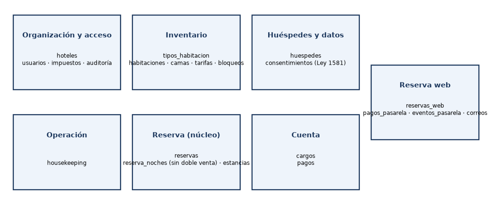
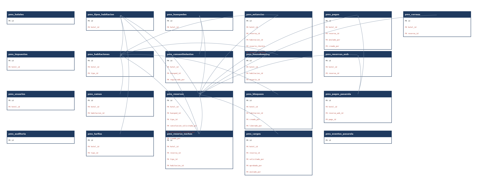
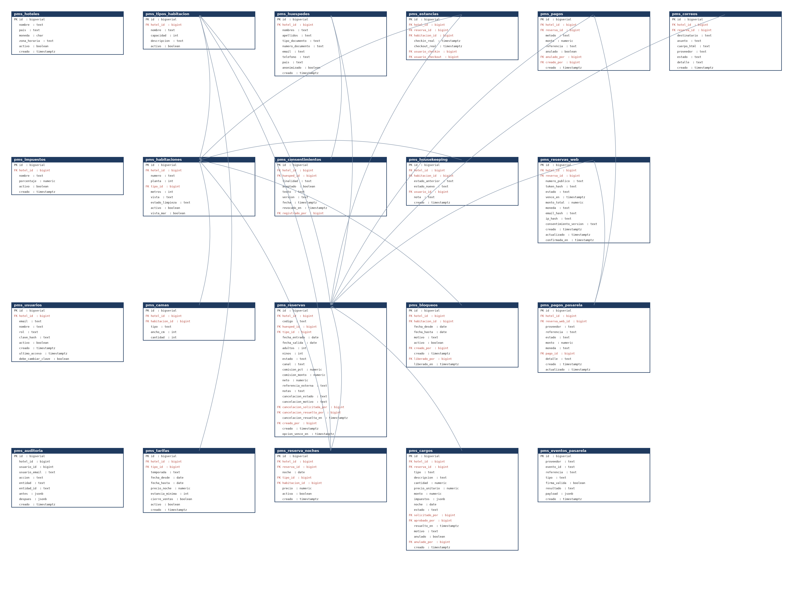
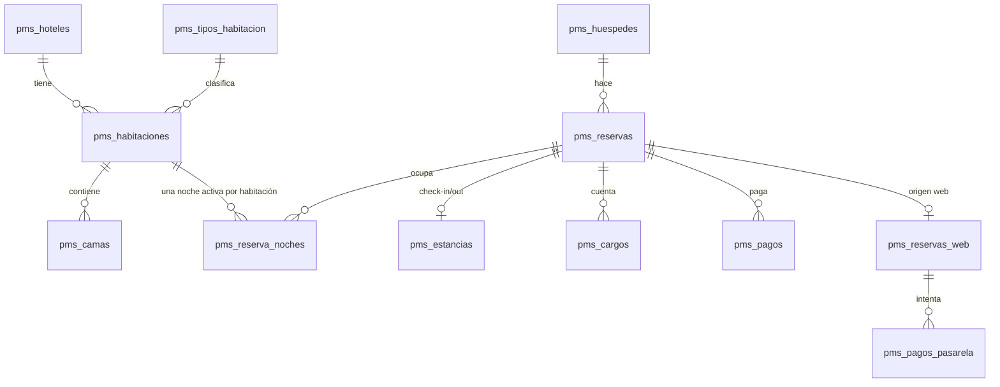

# PMS Hotelero · Piloto — Anexo A · Modelo de datos

*Prototipo diseñado para ATm Consulting · versión 1.0 · 29 de octubre de 2026 · fuente: `db/01_esquema_pms.sql` y `db/02_rls_pms.sql`*

## 1. Vista general del modelo
21 tablas con prefijo `pms_` en el esquema `public` de Supabase (proyecto *atlas-selleragent*), agrupadas en 7 dominios. Casi todas llevan `hotel_id`, que separa los datos de cada hotel.

## 2. Diagrama ER simplificado (llaves)
Solo llaves primarias (PK) y foráneas (FK). Por legibilidad no se dibujan las flechas hacia `pms_hoteles` (todas las tablas con `hotel_id`) ni hacia `pms_usuarios` (columnas de quién creó/aprobó); sí figuran en la tabla de relaciones.

## 3. Diagrama ER completo

### 3.1 Núcleo de reservas (mermaid)

## 4. Diccionario de datos
{{DICCIONARIO}}

## 5. Tabla de relaciones
{{RELACIONES}}

## 6. Cómo fluye una reserva por las tablas
1. **Huésped:** `pms_huespedes` + `pms_consentimientos` (finalidad, versión del texto, fecha).
2. **Reserva:** `pms_reservas` (estado, canal, personas, fechas; `opcion_vence_en` si es opción) y una fila de `pms_reserva_noches` por noche con habitación y **precio congelado**.
3. **Cuenta:** `pms_cargos` (noches, extras, descuentos con aprobación e impuestos congelados en jsonb) y `pms_pagos`.
4. **Check-in/out:** `pms_estancias`; el check-out deja la habitación `sucia` y se registra en `pms_housekeeping`.
5. **Cancelación / no-show:** las noches pasan a `activa = false` y la habitación queda libre.
6. **Reserva web:** `pms_reservas_web` (número público, hash del token, estado, vencimiento) → `pms_pagos_pasarela` → `pms_eventos_pasarela` (idempotencia) → `pms_pagos` (método `pasarela`) → `pms_correos`.
7. Toda acción importante queda en `pms_auditoria`.

### 6.1 Reglas de integridad
- `ux_pms_noche_habitacion` (habitacion_id, noche) **where activa**: sin doble venta.
- `ux_pms_noche_reserva` (reserva_id, noche) where activa.
- `ux_pms_reservas_ref_externa` (hotel_id, canal, referencia_externa): evita duplicar reservas de canales.
- Checks: fechas de salida > entrada, porcentajes 0–100, montos ≥ 0, estados en listas cerradas.

### 6.2 Índices
`ix_pms_reservas_fechas`, `ix_pms_reservas_opcion_vence`, `ix_pms_noches_hotel`, `ix_pms_hk_hab`, `ix_pms_cargos_reserva`, `ix_pms_pagos_reserva`, `ix_pms_aud_hotel`, `ix_pms_rweb_hotel`, `ix_pms_rweb_ip`, `ix_pms_pasarela_rweb`, `ix_pms_correos_reserva`.

### 6.3 Funciones y triggers
`pms_auditoria_inmutable()` con el trigger `pms_auditoria_no_update` (before update or delete): la auditoría es de solo agregar.

### 6.4 RLS
`db/02_rls_pms.sql` activa RLS en todas las tablas `pms_*` **sin políticas** y revoca todo a `anon` y `authenticated` (tablas y secuencias). Resultado: la API REST pública de Supabase no devuelve nada; solo el servidor de las apps accede con `DATABASE_URL`.

### 6.5 Migraciones
El esquema es idempotente (`create … if not exists`, `alter … add column if not exists`): `debe_cambiar_clave`, `vista_mar`, `opcion_vence_en` y el método de pago `pasarela` se agregaron sin borrar datos.
