# Manual de uso por pantalla · PMS Hotelero Suite v2

**PMS Hoteles Piloto · Prototipo diseñado para ATm Consulting**

Versión 1.0 · noviembre de 2026 · Datos 100 % ficticios

> **Cómo leer este manual.** Cada pantalla tiene una captura con **recuadros rojos numerados**. Debajo, una tabla explica qué es cada número y qué significa cada dato. Después vienen los pasos típicos y los mensajes que puede ver el usuario. Todas las capturas se tomaron con una base de datos **local de pruebas**, con hoteles, huéspedes y reservas inventados. No aparece ninguna contraseña real.

## 1. Antes de empezar

### 1.1 Qué es la Suite v2

La Suite v2 es el sistema de gestión del hotel (PMS) en su versión con el diseño nuevo: fondo verde azulado pastel, panel blanco y menú lateral agrupado por categorías. Se usa desde el navegador, sin instalar nada.

| Aplicación | Dirección | Para quién |
|---|---|---|
| Suite v2 (este manual) | https://pms-hoteles-v2-atm.streamlit.app/ | Personal del hotel |
| Mini web de reservas | https://pms-reservas-atm.streamlit.app/ | Clientes del hotel (público) |
| App original | https://pms-hoteles-atm.streamlit.app/ | Personal del hotel |

**La app original tiene las mismas pantallas, con otro aspecto.** Las dos usan la misma base de datos y las mismas reglas, así que este manual sirve para ambas. Solo cambian los colores, la tipografía y el orden del menú. Las pantallas marcadas «fase siguiente» existen solo en la Suite v2, como avance.

### 1.2 Reglas que valen en todas las pantallas

- **Datos ficticios.** Todas las pantallas muestran el aviso amarillo «Prototipo con datos 100 % ficticios». Los correos, los pagos y las integraciones (Booking, Airbnb, pasarelas) son **simulados**: no se envía, cobra ni factura nada real. El comprobante PDF **no es una factura legal**.
- **Cada rol ve solo lo suyo.** El menú lateral muestra únicamente las pantallas que permite el rol del usuario. Algunas pantallas se pueden **consultar** pero no **editar**; en ese caso aparece un aviso azul como «Tu rol solo puede consultar…».
- **Sesión.** La sesión dura 8 horas. Si alguien escribe mal la contraseña 5 veces, la cuenta se bloquea 15 minutos.
- **Pie de página.** Todas las pantallas terminan con el logo de ATm y la frase «Prototipo diseñado para ATm Consulting».
- **Menú plegado.** Si el menú tiene muchas opciones, Streamlit muestra al final «View N more» (ver N más); al pulsarlo aparecen todas y el botón cambia a «View less» (ver menos).

### 1.3 Quién ve cada pantalla

La tabla resume los permisos del sistema (archivo de seguridad del PMS). **Edita** = puede consultar y hacer cambios; **Consulta** = solo mirar; **—** = la pantalla no aparece en su menú.

| Pantalla | Recepción | Gerencia | Housekeeping | Administrador |
|---|---|---|---|---|
| Dashboard | Edita | Edita | — | Consulta |
| Planning (calendario) | Edita | Edita | — | Consulta |
| Plano · Disponibilidad | Edita | Edita | — | Consulta |
| Reservas y Reservas web | Edita | Edita | — | Consulta |
| Huéspedes | Edita | Edita | — | Consulta |
| Housekeeping | Consulta | Edita | Edita | Consulta |
| Tarifas e inventario | Consulta | Edita | — | Edita |
| Bloqueos | Consulta | Edita | Consulta | Edita |
| Facturación | Edita | Edita | — | Consulta |
| Reportes | — | Edita | — | Edita |
| Configuración | — | Consulta | — | Edita |
| Auditoría | — | Consulta | — | Consulta |
| Promos, CRM, Integraciones (fase siguiente) | Ven la página informativa | Ven la página informativa | — | Ven la página informativa |

Algunas acciones tienen además una regla propia, aunque la pantalla sea editable:

- Solo **gerencia** aprueba cancelaciones y descuentos, y nunca la misma persona que los pidió.
- Solo **gerencia** puede forzar un check-out con saldo pendiente y anonimizar a un huésped.
- En Housekeeping, quien pasó una habitación a inspección no puede aprobarla.

### 1.4 Colores que se repiten

**Estados de una reserva** (chips de color en Planning, Reservas y Dashboard):

| Estado | Color | Qué significa |
|---|---|---|
| Consulta | Gris | El cliente preguntó; todavía no aparta habitación. |
| Opción | Amarillo | Reserva provisional que aparta la habitación. Vence sola: 48 h si la creó recepción, 15 min si viene de la web. |
| Confirmada | Azul | Reserva firme. |
| Alojado | Verde | El huésped ya hizo check-in. |
| Salida | Gris | El huésped ya hizo check-out. |
| Cancelada | Rojo | Cancelada con aprobación de gerencia. |
| No se presentó (no-show) | Naranja | El huésped no llegó. |
| Bloqueo | Rojo ladrillo | Habitación fuera de venta por mantenimiento u otro motivo. |

**Estados de limpieza** (Housekeeping y Dashboard): **Sucia** (rojo), **En limpieza** (amarillo), **En inspección** (índigo), **Lista** (verde) y **Fuera de servicio** (gris).

## 2. Ingreso y primer ingreso

### 2.1 Pantalla de ingreso

**Para qué sirve:** entrar al sistema con el correo y la contraseña personales.
**Quién la ve:** todas las personas, antes de iniciar sesión.

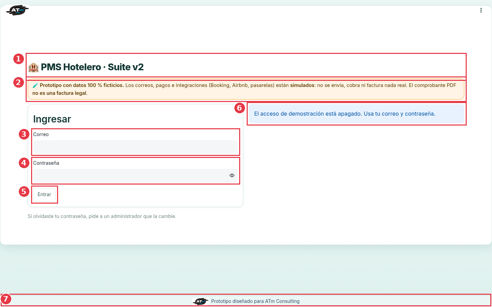

| N.º | Zona | Qué muestra / qué significa |
|---|---|---|
| 1 | Título | «🏨 PMS Hotelero · Suite v2». Confirma que se está en la Suite v2 y no en la app original. |
| 2 | Aviso de prototipo | Recuerda que todos los datos son ficticios y que correos, pagos e integraciones son simulados. |
| 3 | Correo | El correo del usuario, el mismo que creó el administrador. |
| 4 | Contraseña | El ojo de la derecha muestra u oculta lo escrito. |
| 5 | Botón «Entrar» | Valida los datos y abre el sistema. |
| 6 | Panel de demostración | Si el modo demo está apagado (como en la captura), dice «El acceso de demostración está apagado. Usa tu correo y contraseña». Si está encendido, muestra «Acceso rápido de demostración»: se elige un usuario en «Entrar como» y se pulsa «Entrar en modo demo», sin contraseña. Es solo para pruebas. |
| 7 | Pie | Logo de ATm y «Prototipo diseñado para ATm Consulting». |

**Pasos típicos**

1. Escribe tu correo y tu contraseña.
2. Pulsa **Entrar**.
3. Si es tu primer ingreso, el sistema te pide crear una contraseña nueva (sección 2.2). Si no, abre la primera pantalla de tu menú.

**Mensajes frecuentes**

- «Correo o contraseña incorrectos.» Revisa mayúsculas y el correo completo.
- «Demasiados intentos fallidos. Espera 15 minutos e intenta de nuevo.» Aparece tras 5 errores seguidos.
- «Si olvidaste tu contraseña, pide a un administrador que la cambie.» No existe recuperación por correo, porque el correo es simulado.
- «No hay hoteles disponibles para este usuario.» El usuario no tiene un hotel asignado; lo corrige el administrador.

### 2.2 Primer ingreso: crear la contraseña nueva

**Para qué sirve:** cambiar la contraseña temporal que entregó el administrador por una propia.
**Quién la ve:** cualquier usuario marcado «Debe crear su contraseña».

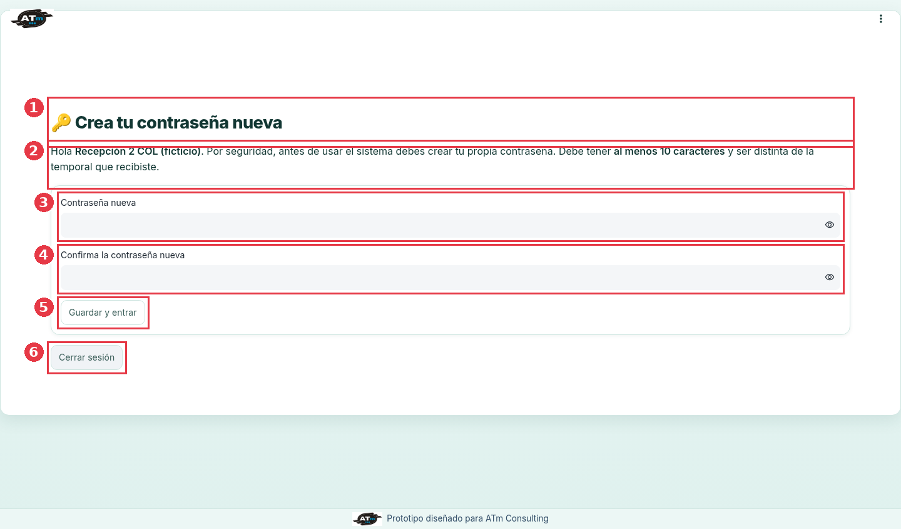

| N.º | Zona | Qué muestra / qué significa |
|---|---|---|
| 1 | Título | «🔑 Crea tu contraseña nueva». |
| 2 | Explicación | Saluda por el nombre y recuerda las reglas: **al menos 10 caracteres** y distinta de la temporal. |
| 3 | Contraseña nueva | La contraseña que usarás desde ahora. |
| 4 | Confirmación | Repite la misma contraseña para evitar errores de tecleo. |
| 5 | «Guardar y entrar» | Guarda la contraseña (cifrada) y abre el sistema. |
| 6 | «Cerrar sesión» | Sale sin cambiar nada. |

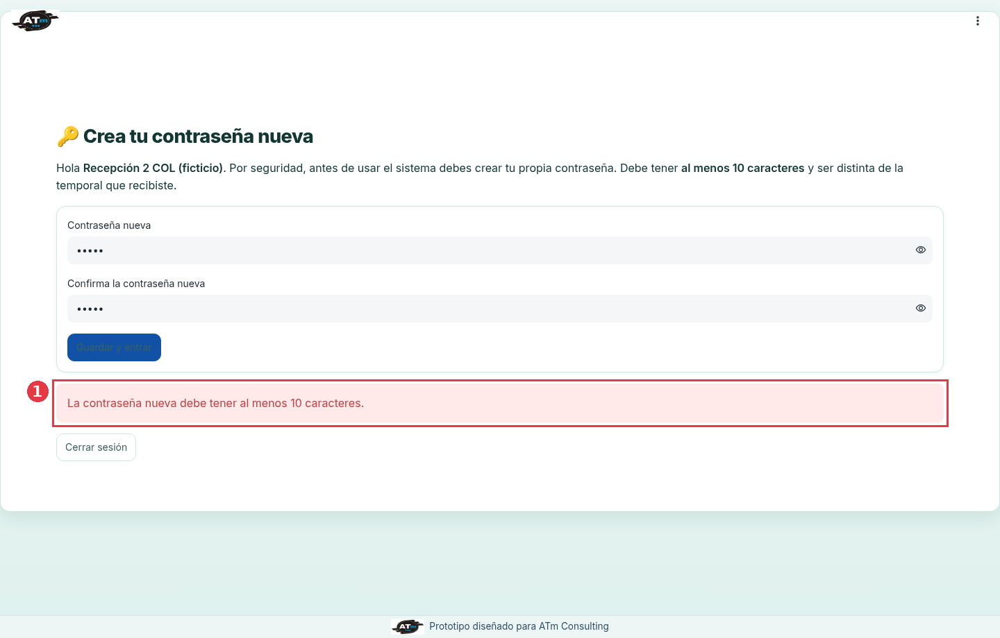

| N.º | Zona | Qué muestra / qué significa |
|---|---|---|
| 1 | Mensaje de error | Explica por qué no se aceptó la contraseña, por ejemplo «La contraseña nueva debe tener al menos 10 caracteres». |

**Otros mensajes:** «La confirmación no coincide con la contraseña nueva.» y «La contraseña nueva no puede ser igual a la temporal.»

### 2.3 Barra lateral y menú (todas las pantallas)

Una vez dentro, la barra lateral izquierda es igual en todas las pantallas.

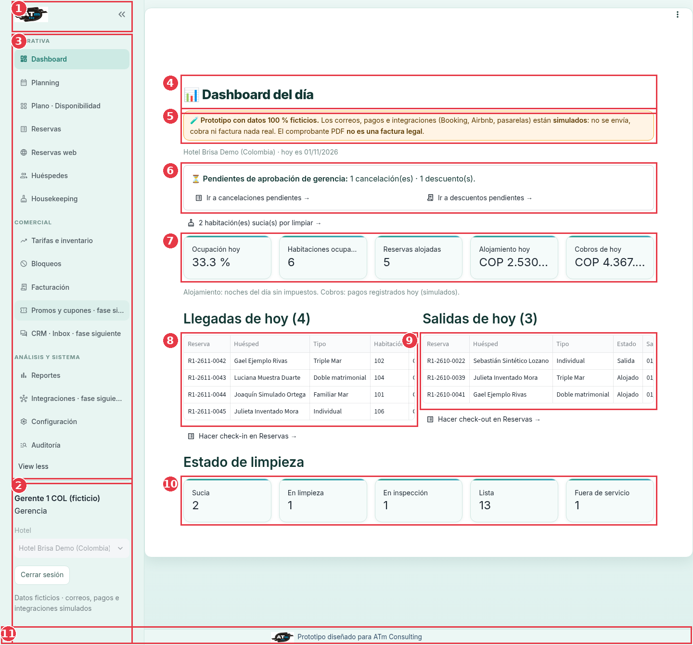

| N.º | Zona | Qué muestra / qué significa |
|---|---|---|
| 1 | Logo | Logo de ATm. La flecha ««» pliega la barra para ganar espacio. |
| 2 | Usuario y hotel | Nombre y rol del usuario, selector **Hotel** (gris si el usuario solo tiene un hotel), botón **Cerrar sesión** y la nota «Datos ficticios · correos, pagos e integraciones simulados». |
| 3 | Menú por categorías | **Operativa**, **Comercial** y **Análisis y sistema**. La pantalla abierta aparece resaltada. Las que dicen «fase siguiente» todavía no están construidas. |
| 11 | Pie | Marca del prototipo. |

Los números 4 a 10 de esta captura se explican en la sección 3.1 (Dashboard).

**Menú según el rol.** Housekeeping ve solo **Housekeeping** y **Bloqueos**. Recepción no ve Reportes, Configuración ni Auditoría.

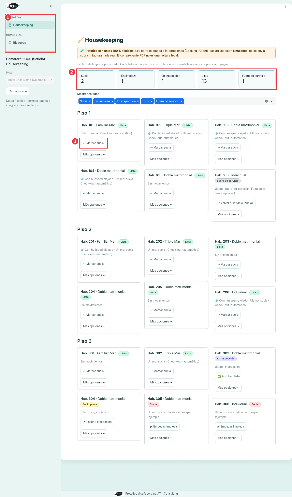

| N.º | Zona | Qué muestra / qué significa |
|---|---|---|
| 1 | Menú reducido | Housekeeping (Operativa) y Bloqueos (Comercial). Este rol no ve precios ni datos de huéspedes. |
| 2 | Indicadores de limpieza | Cuántas habitaciones hay en cada estado (ver sección 3.7). |
| 3 | Botón de acción | El siguiente paso de limpieza de cada habitación. |

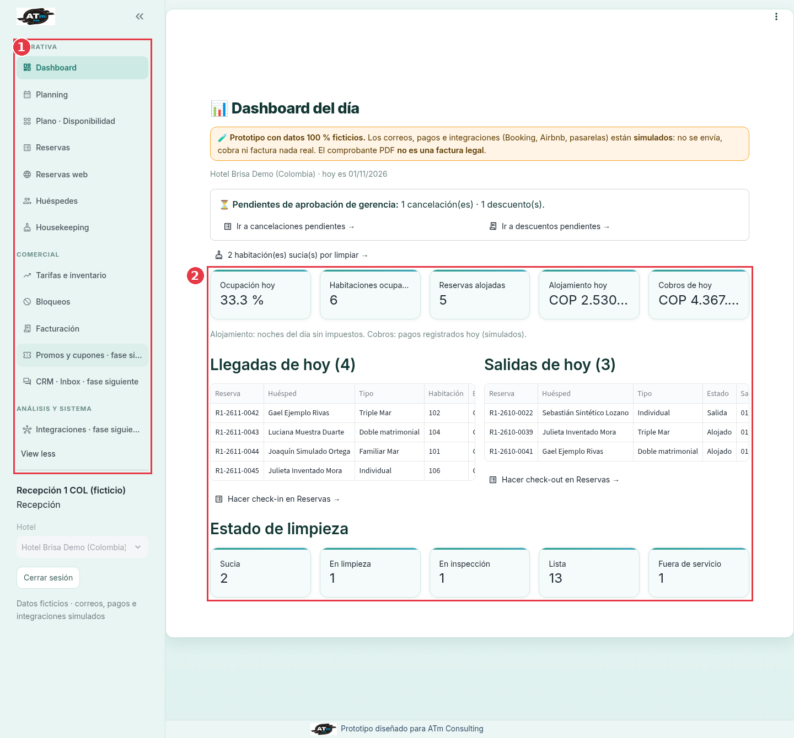

| N.º | Zona | Qué muestra / qué significa |
|---|---|---|
| 1 | Menú de recepción | Toda la categoría Operativa; en Comercial, Tarifas, Bloqueos, Facturación y las páginas de fase siguiente; en Análisis, solo Integraciones (fase siguiente). |
| 2 | Dashboard | Recepción ve el mismo tablero del día que gerencia. |

## 3. Operativa

### 3.1 Dashboard

**Para qué sirve:** ver de un vistazo cómo está el hotel **hoy**: ocupación, llegadas, salidas, cobros, limpieza y lo que espera aprobación de gerencia.
**Quién la ve:** Recepción y Gerencia (pueden usar los enlaces de acción); Administrador (solo consulta). Housekeeping no la ve.

| N.º | Zona | Qué muestra / qué significa |
|---|---|---|
| 4 | Título y fecha | «📊 Dashboard del día», con el nombre del hotel y la fecha de hoy **en la zona horaria del hotel**. |
| 5 | Aviso de prototipo | Datos ficticios; correos, pagos e integraciones simulados. |
| 6 | Pendientes de gerencia | Cuántas **cancelaciones** y cuántos **descuentos** esperan aprobación, con enlaces directos a cada lista. Solo aparece si hay alguno. Debajo, el enlace «N habitación(es) sucia(s) por limpiar →» lleva a Housekeeping. |
| 7 | Indicadores del día | **Ocupación hoy**: porcentaje de habitaciones ocupadas esta noche. **Habitaciones ocupadas**: cuántas son. **Reservas alojadas**: reservas con el huésped en el hotel (check-in hecho). **Alojamiento hoy**: valor de las noches de hoy, **sin impuestos**. **Cobros de hoy**: pagos registrados hoy (simulados). Si una cifra es larga, termina en «…»; al pasar el cursor se ve completa. |
| 8 | Llegadas de hoy (n) | Reservas que entran hoy: código, huésped, tipo, habitación y estado. El enlace «Hacer check-in en Reservas →» abre la gestión de reservas. Si no hay, dice «No hay llegadas hoy.» |
| 9 | Salidas de hoy (n) | Reservas que salen hoy, con su estado («Alojado» si aún no hizo check-out, «Salida» si ya lo hizo). Enlace «Hacer check-out en Reservas →». |
| 10 | Estado de limpieza | Cuántas habitaciones hay **Sucias**, **En limpieza**, **En inspección**, **Listas** y **Fuera de servicio**. Solo aparece si el rol puede ver Housekeeping. |

**Pasos típicos (inicio de turno de recepción)**

1. Revisa las **Llegadas de hoy** y comprueba en **Estado de limpieza** que haya habitaciones listas.
2. Si gerencia tiene pendientes (zona 6), entra por el enlace y resuélvelos.
3. Durante el día, usa los enlaces para hacer check-in y check-out en **Reservas**.

### 3.2 Planning (calendario de ocupación)

**Para qué sirve:** ver qué habitación está ocupada cada noche, en una rejilla de **solo lectura** (habitaciones × días).
**Quién la ve:** Recepción y Gerencia; Administrador solo consulta.

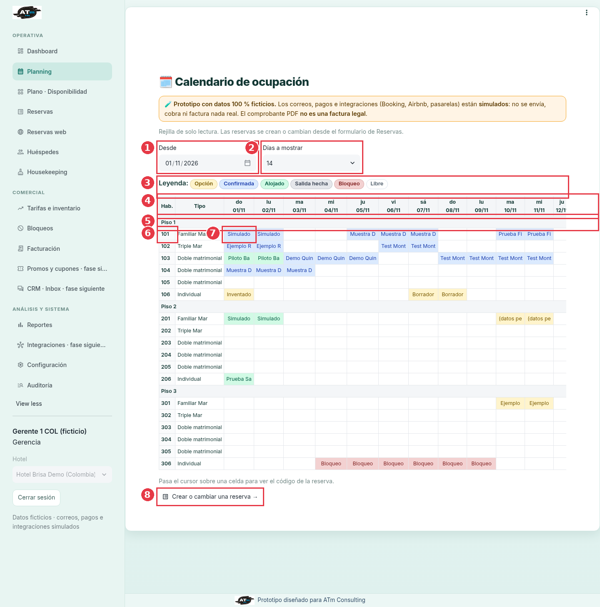

| N.º | Zona | Qué muestra / qué significa |
|---|---|---|
| 1 | Desde | Primer día que se muestra (por defecto, hoy). |
| 2 | Días a mostrar | Ancho de la rejilla: 7, 14, 21 o 30 días. |
| 3 | Leyenda | Colores de la rejilla: **Opción** (amarillo), **Confirmada** (azul), **Alojado** (verde), **Salida hecha** (gris), **Bloqueo** (rojo) y **Libre** (blanco). |
| 4 | Encabezado de días | Día de la semana abreviado (lu, ma, mi…) y fecha dd/mm. Cada columna es una **noche**. |
| 5 | Fila de piso | Separa las habitaciones por planta («Piso 1», «Piso 2»…). |
| 6 | Habitación y tipo | Número de la habitación y su tipo (Familiar Mar, Doble matrimonial…). |
| 7 | Celda ocupada | Muestra las primeras 9 letras del huésped (o «Bloqueo»). Al **pasar el cursor** aparece el código de la reserva y su estado. |
| 8 | Enlace | «Crear o cambiar una reserva →» abre la pantalla Reservas. |

**Cómo leerla:** una franja del mismo color en varias columnas es una estancia; la salida se ve como la primera columna libre después de la franja. En la captura, la habitación 306 tiene un **Bloqueo** de varios días (mantenimiento). Para cambiar algo hay que ir a **Reservas** o **Bloqueos**: esta rejilla no se edita.

### 3.3 Plano · Disponibilidad

**Para qué sirve:** elegir una habitación **sobre el dibujo de cada planta**, viendo cuáles están libres en las fechas buscadas, sus camas, si tienen vista al mar y el precio total. Desde aquí se empieza una reserva.
**Quién la ve:** Recepción y Gerencia (pueden elegir y continuar); Administrador solo consulta («Tu rol solo puede consultar el plano»).

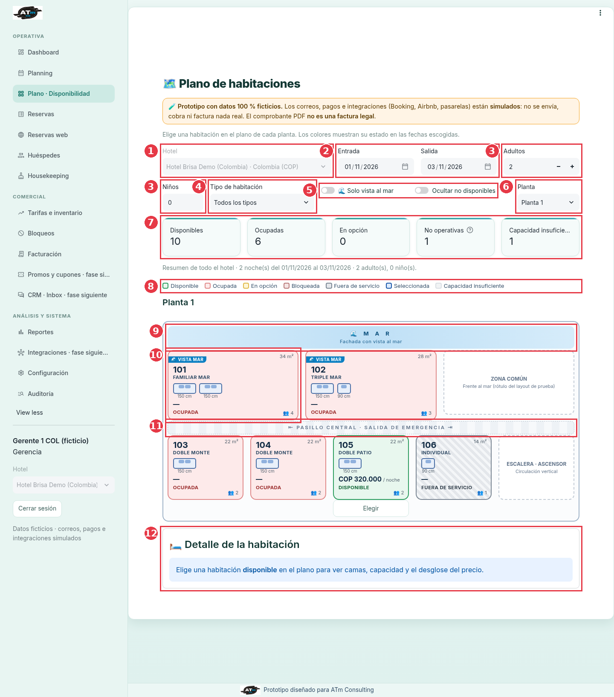

| N.º | Zona | Qué muestra / qué significa |
|---|---|---|
| 1 | Hotel | Hotel que se consulta (con su país y moneda). |
| 2 | Entrada y Salida | Fechas de la estancia. La salida debe ser posterior a la entrada. |
| 3 | Adultos y Niños | Personas que se alojarán. Sirve para descartar habitaciones con poca capacidad. |
| 4 | Tipo de habitación | «Todos los tipos» o un tipo concreto. Cada opción indica su capacidad, por ejemplo «Doble matrimonial (hasta 2)». |
| 5 | Interruptores | **🌊 Solo vista al mar**: deja solo las habitaciones con vista al mar. **Ocultar no disponibles**: quita del dibujo las que no se pueden vender. |
| 6 | Planta | Piso que se dibuja abajo. |
| 7 | Indicadores | **Disponibles**: libres y con capacidad suficiente. **Ocupadas**: vendidas en alguna noche del rango. **En opción**: apartadas por una reserva provisional. **No operativas**: bloqueadas o fuera de servicio. **Capacidad insuficiente**: libres, pero con menos plazas que las personas buscadas. Debajo, un resumen: noches, fechas y personas. |
| 8 | Leyenda | Borde **verde**: disponible. **Rojo**: ocupada. **Amarillo**: en opción. **Rojo rayado**: bloqueada. **Gris rayado**: fuera de servicio. **Azul**: seleccionada. **Gris claro**: capacidad insuficiente. |
| 9 | Franja «🌊 MAR» | Indica la fachada con vista al mar. La fila de arriba es la que da al mar; a su lado está la **ZONA COMÚN** («Frente al mar»). |
| 10 | Tarjeta de habitación | Número, tipo, etiqueta **🌊 VISTA MAR** si la tiene, metros cuadrados, **dibujo de las camas** con su ancho (150 cm matrimonial, 90 cm individual), precio por noche («—» si no está disponible, «Sin tarifa» si falta tarifa), estado y capacidad (👥). Las disponibles tienen debajo el botón **Elegir**. |
| 11 | Pasillo central | «PASILLO CENTRAL · SALIDA DE EMERGENCIA». Separa la fila del mar de la fila interior. Al final de la fila interior está **ESCALERA · ASCENSOR**. |
| 12 | Detalle de la habitación | Vacío hasta que se elige una habitación (ver la siguiente captura). |

El dibujo usa una **distribución provisional** de prueba (3 pisos × 6 habitaciones). Las camas son informativas: **se vende la habitación completa**, no la cama.

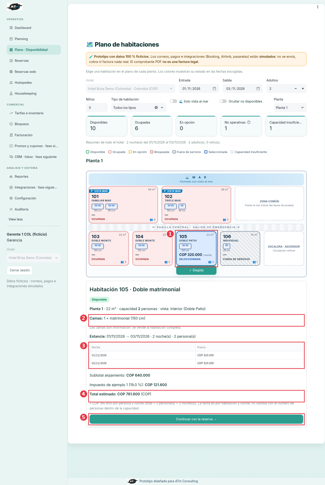

| N.º | Zona | Qué muestra / qué significa |
|---|---|---|
| 1 | Habitación elegida | La tarjeta pasa a azul («Seleccionada») y el botón dice «✓ Elegida». |
| 2 | Ficha | Encima: nombre «Habitación N · tipo», chip «Disponible» (y 🌊 si tiene vista al mar), planta, m², capacidad y vista. En el recuadro: **Camas**, con la nota de que se vende la habitación completa. |
| 3 | Noches | Tabla con cada noche y su precio según la tarifa vigente. |
| 4 | Total estimado | Por encima del total: **Subtotal alojamiento** e impuesto de ejemplo con su porcentaje. **Total estimado** en la moneda del hotel; debajo, el valor aproximado **por persona y noche**. La tarifa es por habitación y noche: no cambia con el número de personas, dentro de la capacidad. |
| 5 | «Continuar con la reserva →» | Abre **Reservas › Nueva reserva** con la habitación, las fechas y las personas ya escritas. |

**Pasos típicos**

1. Elige fechas y personas (zonas 2 y 3).
2. Cambia de **Planta** y busca tarjetas verdes; si quieres, activa **Solo vista al mar**.
3. Pulsa **Elegir** en una habitación y revisa el detalle y el total.
4. Pulsa **Continuar con la reserva →** y termina la reserva (sección 3.4).

**Mensajes frecuentes**

- «La fecha de salida debe ser posterior a la de entrada.»
- «Ninguna habitación de esta planta cumple los filtros.» Prueba otra planta o quita filtros.
- «Este hotel no tiene habitaciones activas. Se crean en Configuración.»
- «Para el plano elige una estancia de máximo N noches.»
- «La habitación N ya no está disponible para esas fechas (…).» Otra persona la tomó mientras mirabas; elige otra.

### 3.4 Reservas

**Para qué sirve:** crear, buscar y cambiar reservas; hacer check-in, check-out y no-show; pedir y aprobar cancelaciones. El precio de cada noche se **congela** al reservar.
**Quién la ve:** Recepción y Gerencia (editan); Administrador solo consulta («Tu rol solo puede consultar reservas»). La pantalla tiene cuatro pestañas.

#### Pestaña 📋 Lista

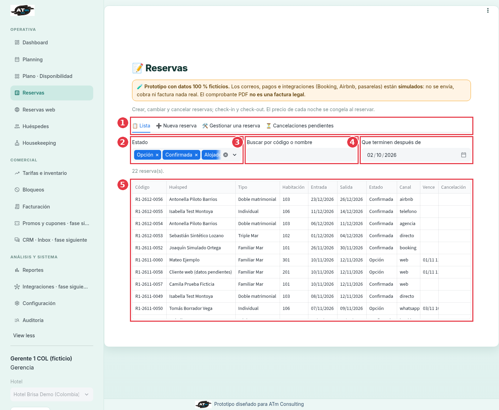

| N.º | Zona | Qué muestra / qué significa |
|---|---|---|
| 1 | Pestañas | 📋 Lista · ➕ Nueva reserva · 🛠️ Gestionar una reserva · ⏳ Cancelaciones pendientes. |
| 2 | Estado | Filtro de varios estados a la vez. Por defecto: Opción, Confirmada y Alojado (las vigentes). La «×» quita un estado. |
| 3 | Buscar por código o nombre | Escribe parte del código (R1-…) o del nombre del huésped. |
| 4 | Que terminen después de | Muestra solo reservas cuya salida es posterior a esta fecha. |
| 5 | Tabla | **Código**, **Huésped**, **Tipo**, **Habitación**, **Entrada**, **Salida**, **Estado**, **Canal** (directo, teléfono, WhatsApp, Booking, Airbnb, agencia, web…), **Vence** (fecha y hora en que caduca una opción) y **Cancelación** (si hay una solicitud). Encima, el total de reservas encontradas. |

#### Pestaña ➕ Nueva reserva

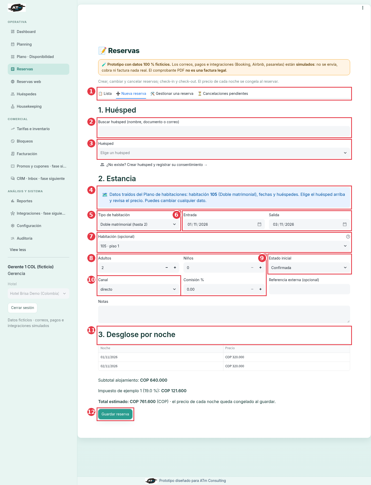

| N.º | Zona | Qué muestra / qué significa |
|---|---|---|
| 1 | Pestañas | La pestaña activa es «Nueva reserva». |
| 2 | 1. Huésped · buscar | Busca por nombre, documento o correo. |
| 3 | Huésped | Elige la ficha. Debajo, un aviso verde «✅ Tiene consentimiento de tratamiento de datos vigente» o amarillo «Falta el consentimiento (Ley 1581)…». Sin consentimiento **no se puede reservar**. El enlace «¿No existe? Crear huésped…» abre Huéspedes. |
| 4 | Aviso del plano | Aparece si vienes del Plano: indica la habitación, las fechas y las personas traídas. Puedes cambiar cualquier dato. |
| 5 | Tipo de habitación | Con su capacidad máxima. |
| 6 | Entrada y Salida | Fechas de la estancia. |
| 7 | Habitación (opcional) | Una habitación concreta del tipo. Si se deja vacía, el sistema **asigna una automáticamente**. |
| 8 | Adultos, Niños y Comisión % | Personas, y comisión del canal. Al elegir canal se sugiere: Booking 15 %, Airbnb 3 %, agencia 10 %. |
| 9 | Estado inicial | Consulta, Opción o **Confirmada** (por defecto). |
| 10 | Canal | Directo, teléfono, WhatsApp, Booking, Airbnb, agencia u otro. Al lado, **Referencia externa** (el código del canal). No hay conexión real con los canales. |
| 11 | 3. Desglose por noche | Precio de cada noche, **Subtotal alojamiento**, impuesto y **Total estimado**. Si hay comisión, muestra la comisión estimada y el neto. |
| 12 | «Guardar reserva» | Crea la reserva y congela los precios. |

#### Pestaña 🛠️ Gestionar una reserva

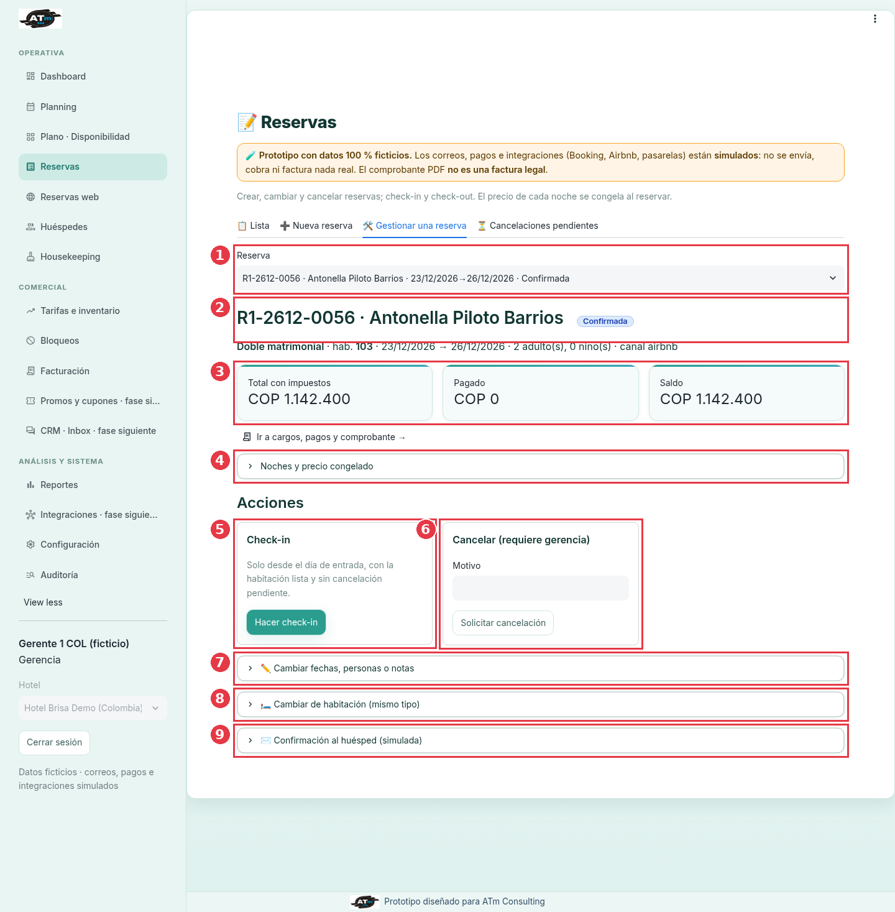

| N.º | Zona | Qué muestra / qué significa |
|---|---|---|
| 1 | Reserva | Selector: código · huésped · fechas · estado. |
| 2 | Encabezado | Código, huésped y chip de estado. Debajo: tipo, habitación, fechas, personas y canal. |
| 3 | Importes | **Total con impuestos**, **Pagado** y **Saldo** (lo que falta pagar). El enlace «Ir a cargos, pagos y comprobante →» abre Facturación. |
| 4 | Noches y precio congelado | Desplegable con cada noche, su habitación, el precio que quedó fijo y si está activa. |
| 5 | Check-in / Check-out | **Check-in** aparece en reservas confirmadas: solo desde el día de entrada, con la habitación **lista** y sin cancelación pendiente. En reservas alojadas aparece **Check-out**: la habitación pasa a **sucia**. Con saldo pendiente, solo gerencia ve «Forzar salida con saldo (gerencia)». |
| 6 | Cancelar (requiere gerencia) | Escribe el **Motivo** y pulsa **Solicitar cancelación**. La reserva sigue vigente hasta que gerencia apruebe. Si la reserva es confirmada y la entrada ya pasó, aparece además el recuadro **No-show** («Marcar no-show»), que libera la habitación. |
| 7 | ✏️ Cambiar fechas, personas o notas | Nueva entrada, nueva salida, adultos, niños y notas. Las noches que ya tenía **conservan su precio**; solo las nuevas usan la tarifa vigente. |
| 8 | 🛏️ Cambiar de habitación (mismo tipo) | Mueve la reserva a otra habitación del mismo tipo. |
| 9 | ✉️ Confirmación al huésped (simulada) | «Simular envío de confirmación» solo deja constancia en la auditoría; no se envía nada. |

#### Pestaña ⏳ Cancelaciones pendientes

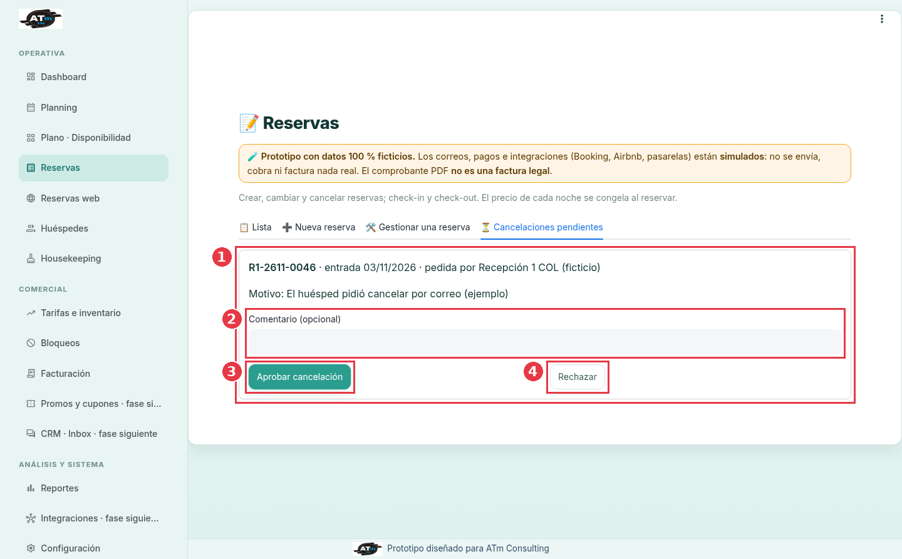

| N.º | Zona | Qué muestra / qué significa |
|---|---|---|
| 1 | Solicitud | Código de la reserva, fecha de entrada, quién la pidió y el **motivo**. |
| 2 | Comentario (opcional) | Nota de gerencia que queda en la auditoría. |
| 3 | «Aprobar cancelación» | Cancela la reserva y libera sus noches. Solo gerencia, y **nunca quien la pidió**. |
| 4 | «Rechazar» | La reserva sigue como estaba. |

**Mensajes frecuentes en Reservas**

- «El huésped no tiene un consentimiento de datos vigente (Ley 1581).»
- «La estancia mínima para entrar el dd/mm/aaaa es de N noches.» o «Las ventas están cerradas para la noche del…»: lo define Tarifas.
- «No hay disponibilidad de este tipo la noche del…» o «No hay tarifa configurada para la noche del…»
- «El tipo «X» admite máximo N personas.»
- «La habitación N aún no está lista (limpia e inspeccionada).»: hay que esperar a Housekeeping antes del check-in.
- «El check-in solo se hace entre la fecha de entrada (…) y la de salida.»
- «La reserva tiene un saldo pendiente de …: registra el pago antes del check-out.»
- «Hay una cancelación pendiente de aprobación: no se puede modificar la reserva.»
- «Ya existe una reserva con esa referencia externa en ese canal.»

**Vencimiento automático.** Una **opción** creada por recepción vence a las 48 horas. Una reserva web sin pagar vence a los 15 minutos. Al vencer, la habitación vuelve a estar libre.

### 3.5 Reservas web

**Para qué sirve:** seguir las reservas que hacen los clientes en la **mini web pública**: si la habitación sigue bloqueada, si el pago se aprobó y si salió el correo de confirmación.
**Quién la ve:** Recepción y Gerencia; Administrador solo consulta. Usa el mismo permiso que Reservas.

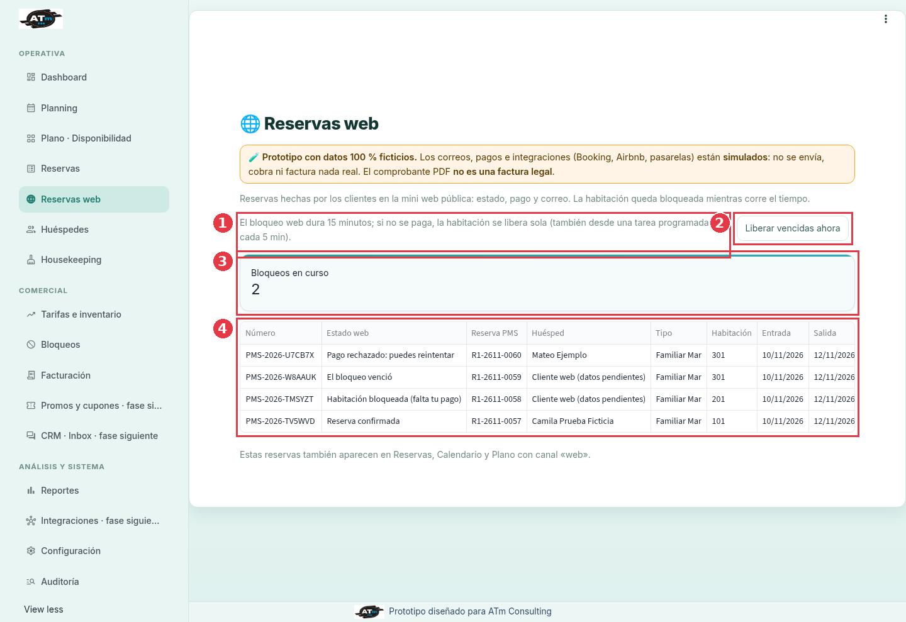

| N.º | Zona | Qué muestra / qué significa |
|---|---|---|
| 1 | Regla del bloqueo | El bloqueo web dura **15 minutos**. Si el cliente no paga, la habitación se libera sola; también la libera una tarea programada que corre cada 5 minutos. |
| 2 | «Liberar vencidas ahora» | Libera en el momento los bloqueos que ya vencieron, sin esperar la tarea programada. Muestra «Se liberaron N reserva(s) vencida(s).» |
| 3 | Bloqueos en curso | Reservas web que en este momento tienen una habitación apartada. |
| 4 | Tabla | **Número** (PMS-AAAA-XXXXXX, el que recibe el cliente); **Estado web** en lenguaje simple, por ejemplo «Habitación bloqueada (falta tu pago)», «Pago rechazado: puedes reintentar», «El bloqueo venció» o «Reserva confirmada»; **Reserva PMS** (código interno R1-…); **Huésped**, **Tipo**, **Habitación**, **Entrada** y **Salida**. Más a la derecha (hay que desplazar la tabla): **Total**, **Pagado**, **Pago** (Pendiente, Aprobada, Rechazada, Vencida o ⚠️ Requiere revisión), **Referencia** de la pasarela, **Vence** (hora en que caduca el bloqueo) y **Correo** («Simulado (no se envió)», «Enviado» o «Error»). |

Debajo de la tabla se recuerda que estas reservas también aparecen en Reservas, Planning y Plano con canal «web».

**Mensajes frecuentes**

- «Hay pagos que requieren revisión manual (llegaron cuando la habitación ya no estaba libre). Revisa la columna «Pago».» Gerencia debe decidir qué hacer con ese pago.
- «Todavía no hay reservas hechas desde la web.»

### 3.6 Huéspedes

**Para qué sirve:** buscar y editar la ficha de cada huésped y registrar sus **consentimientos de tratamiento de datos** (Ley 1581 de 2012, Colombia).
**Quién la ve:** Recepción y Gerencia (editan); Administrador solo consulta. Solo gerencia puede anonimizar.

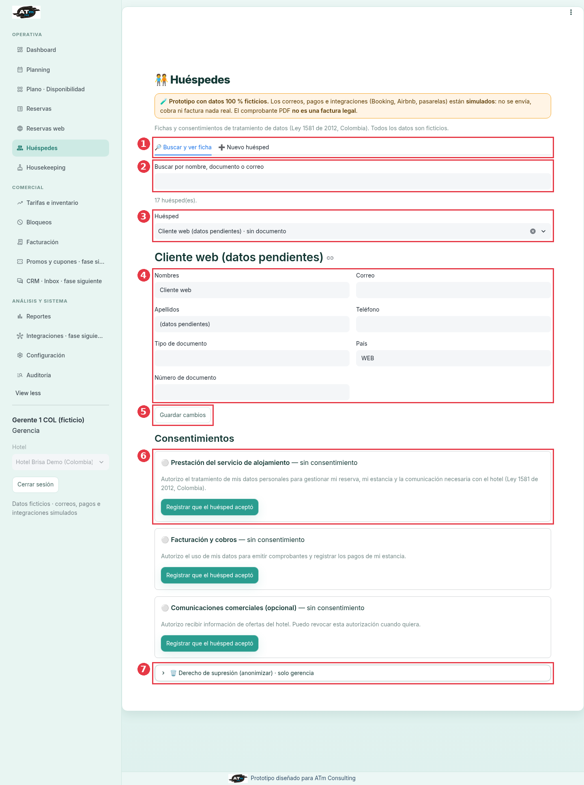

| N.º | Zona | Qué muestra / qué significa |
|---|---|---|
| 1 | Pestañas | 🔎 Buscar y ver ficha · ➕ Nuevo huésped. |
| 2 | Buscar | Por nombre, documento o correo. Debajo, cuántos huéspedes coinciden. |
| 3 | Huésped | Elige la ficha («Elige un huésped»). |
| 4 | Ficha | Nombres, Apellidos, Tipo y Número de documento, Correo, Teléfono y País. En la captura, un cliente que reservó por la web y aún no completó todos sus datos. |
| 5 | «Guardar cambios» | Guarda la ficha. Valida el formato del correo y del teléfono. |
| 6 | Consentimientos | Una tarjeta por finalidad: **Prestación del servicio de alojamiento** (necesaria para reservar), **Facturación y cobros** y **Comunicaciones comerciales (opcional)**. ✅ «vigente» o ⚪ «sin consentimiento». Botones **Registrar que el huésped aceptó** y **Revocar**. Cuando hay registros, aparece el desplegable «Historial de consentimientos» (finalidad, versión del texto, fecha, aceptado, revocado). |
| 7 | 🗑️ Derecho de supresión (anonimizar) · solo gerencia | Borra los datos personales de forma definitiva. Hay que marcar «Entiendo que no se puede deshacer». No se puede si el huésped tiene reservas vigentes. |

**Pestaña ➕ Nuevo huésped:** nombres, apellidos, tipo de documento (CC, CE, Pasaporte, Cédula RD, DNI u Otro), número, correo, teléfono, país y la casilla «El huésped aceptó el tratamiento de sus datos para la prestación del servicio (Ley 1581)». Botón **Crear huésped**. Sin esa casilla la ficha se crea, pero el huésped **no podrá reservar** hasta registrar su consentimiento.

**Mensajes frecuentes:** «Nombres y apellidos son obligatorios.», «El correo no es válido.», «El teléfono no es válido.», «El huésped tiene reservas vigentes: cancélalas o termina la estancia antes de anonimizar.» y «Ficha anonimizada: ya no contiene datos personales.»

### 3.7 Housekeeping

**Para qué sirve:** llevar el estado de limpieza de cada habitación con un botón por paso. **No muestra precios ni pagos.**
**Quién la ve:** Housekeeping y Gerencia (editan); Recepción y Administrador solo consultan («Tu rol solo puede consultar el tablero»).

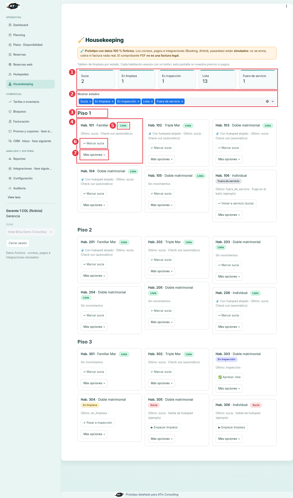

| N.º | Zona | Qué muestra / qué significa |
|---|---|---|
| 1 | Indicadores | Cuántas habitaciones hay **Sucias**, **En limpieza**, **En inspección**, **Listas** y **Fuera de servicio**. |
| 2 | Mostrar estados | Filtro: quita un estado con la «×» para ver solo, por ejemplo, las sucias. |
| 3 | Piso | Las tarjetas se agrupan por planta. |
| 4 | Tarjeta de habitación | «Hab. N · tipo», chip de estado, «🧳 Con huésped alojado» si hay alguien dentro y el **último movimiento** («Último: sucia · Check-out (automático)») o «Sin movimientos». |
| 5 | Chip de estado | Rojo **Sucia**, amarillo **En limpieza**, índigo **En inspección**, verde **Lista** y gris **Fuera de servicio**. |
| 6 | Botón del siguiente paso | **▶ Empezar limpieza** (sucia → en limpieza), **✔ Pasar a inspección**, **✅ Aprobar: lista**, **↩ Marcar sucia** (lista → sucia) y **↩ Volver a servicio (sucia)**. |
| 7 | «Más opciones» | Ventana con **Cambiar a** (otro estado permitido), una **Nota**, obligatoria si queda fuera de servicio, y **Aplicar cambio**. |

**Ciclo normal:** Sucia → En limpieza → En inspección → Lista. El check-out deja la habitación **sucia** automáticamente. El check-in exige que esté **lista**.

**Mensajes frecuentes**

- «Quien dejó la habitación en inspección no puede aprobarla: la debe revisar otra persona.»
- «Escribe el motivo para dejar la habitación fuera de servicio.»
- «La habitación tiene un huésped alojado: cámbialo de habitación antes de ponerla fuera de servicio.»
- «No se puede pasar de «X» a «Y».» (el cambio no está permitido).

## 4. Comercial

### 4.1 Tarifas e inventario

**Para qué sirve:** definir el **precio por noche** de cada tipo de habitación por temporada, la estancia mínima y el cierre de ventas. Los precios están en la moneda del hotel. Cambiar una tarifa **no altera** las reservas ya hechas, porque sus precios están congelados.
**Quién la ve:** Gerencia y Administrador (editan); Recepción solo consulta.

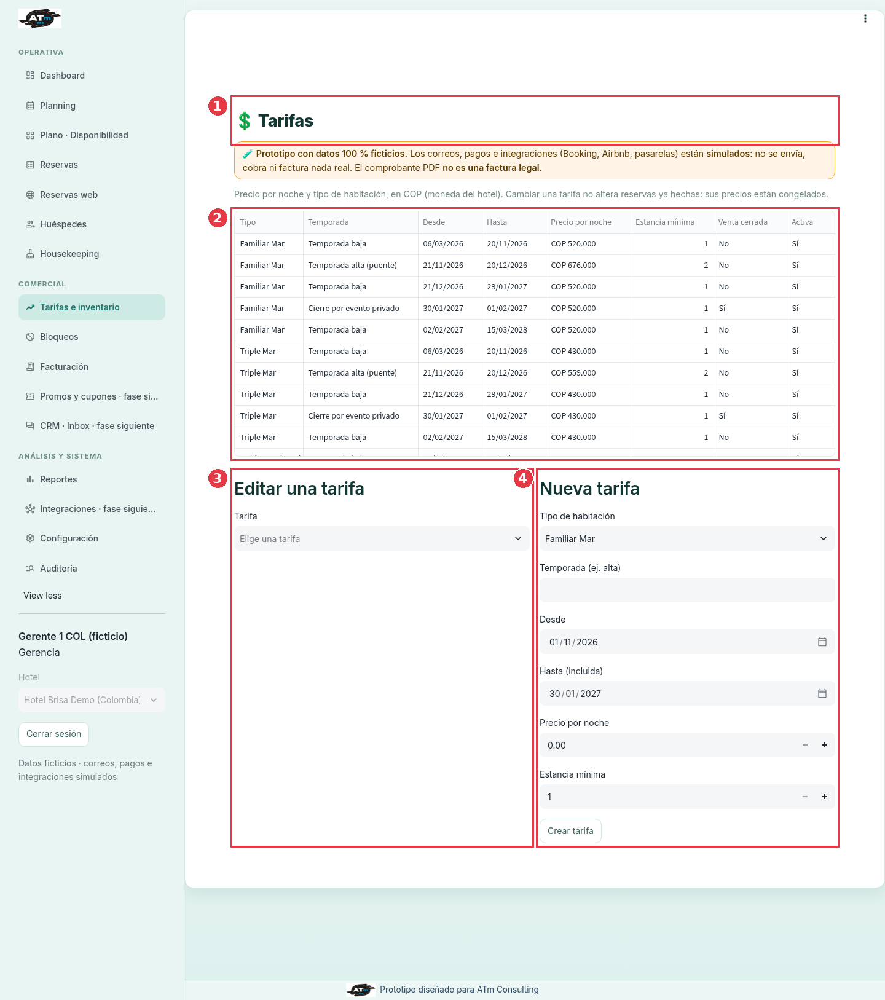

| N.º | Zona | Qué muestra / qué significa |
|---|---|---|
| 1 | Título | «💲 Tarifas». Debajo, la moneda y la regla del precio congelado. |
| 2 | Tabla de tarifas | **Tipo**, **Temporada** (baja, alta, cierre por evento…), **Desde** y **Hasta**, **Precio por noche**, **Estancia mínima** (noches), **Venta cerrada** (Sí = no se puede vender esas noches) y **Activa**. |
| 3 | Editar una tarifa | Elige una tarifa («Elige una tarifa») y aparecen **Precio por noche**, **Estancia mínima (noches)**, la casilla **Cerrar la venta** y **Guardar tarifa**. |
| 4 | Nueva tarifa | **Tipo de habitación**, **Temporada (ej. alta)**, **Desde**, **Hasta (incluida)**, **Precio por noche**, **Estancia mínima** y **Crear tarifa**. |

**Mensajes frecuentes:** «Las fechas se cruzan con la tarifa «X» de este tipo de habitación.» (dos tarifas del mismo tipo no pueden solaparse), «La fecha final de la tarifa no puede ser anterior a la inicial.» y «El precio no puede ser negativo.»

### 4.2 Bloqueos

**Para qué sirve:** sacar una habitación de la venta unas noches, por mantenimiento u otro motivo. **No se puede bloquear una noche ya vendida.**
**Quién la ve:** Gerencia y Administrador (editan); Recepción y Housekeeping solo consultan («Tu rol solo puede consultar los bloqueos»).

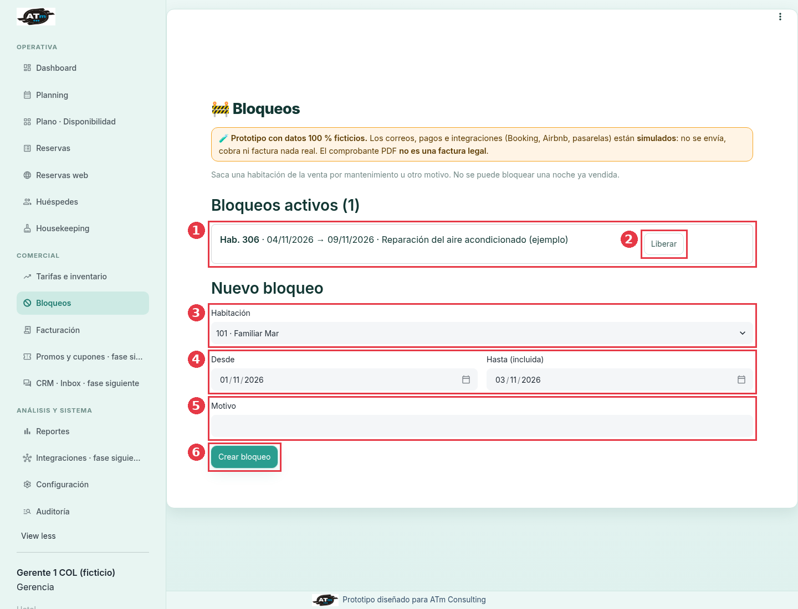

| N.º | Zona | Qué muestra / qué significa |
|---|---|---|
| 1 | Bloqueo activo | Habitación, desde → hasta y motivo. El título indica cuántos hay («Bloqueos activos (1)»). |
| 2 | «Liberar» | Termina el bloqueo y la habitación vuelve a la venta. |
| 3 | Habitación | Habitación que se bloquea. |
| 4 | Desde y Hasta (incluida) | Noches del bloqueo; la fecha «Hasta» también queda bloqueada. |
| 5 | Motivo | Obligatorio; queda en la auditoría. |
| 6 | «Crear bloqueo» | Crea el bloqueo. Se verá en Planning (color rojo ladrillo) y en el Plano como no disponible. |

**Mensajes frecuentes:** «Escribe el motivo del bloqueo.», «La habitación N tiene noches vendidas en ese rango (por ejemplo la reserva …)» y «No hay bloqueos activos.»

### 4.3 Facturación

**Para qué sirve:** ver la **cuenta** de una reserva (noches, extras, impuestos, pagos y saldo), registrar pagos de prueba, pedir descuentos y descargar un **comprobante PDF**. El comprobante es interno: **no es una factura legal ni electrónica**.
**Quién la ve:** Recepción y Gerencia (editan); Administrador solo consulta («Tu rol solo puede consultar la facturación»).

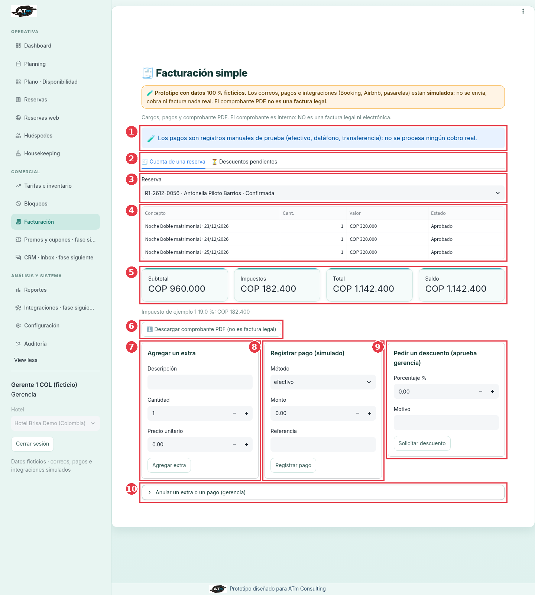

| N.º | Zona | Qué muestra / qué significa |
|---|---|---|
| 1 | Aviso de pagos simulados | «Los pagos son registros manuales de prueba (efectivo, datáfono, transferencia): no se procesa ningún cobro real.» |
| 2 | Pestañas | 🧾 Cuenta de una reserva · ⏳ Descuentos pendientes. |
| 3 | Reserva | Elige la reserva (código · huésped · estado). |
| 4 | Cargos | **Concepto** (cada noche, cada extra, cada descuento), **Cant.**, **Valor** y **Estado** (Aprobado, Pendiente de gerencia, Rechazado o Anulado). |
| 5 | Totales | **Subtotal** (sin impuestos), **Impuestos**, **Total** y **Saldo** (lo que falta pagar). Debajo, el detalle del impuesto aplicado. Si hay pagos, aparece la tabla **Pagos** (fecha, método, monto, referencia y si fue anulado). |
| 6 | «⬇️ Descargar comprobante PDF (no es factura legal)» | Descarga el resumen de la cuenta. |
| 7 | Agregar un extra | **Descripción**, **Cantidad** y **Precio unitario**, y el botón **Agregar extra** (minibar, lavandería…). |
| 8 | Registrar pago (simulado) | **Método** (efectivo, datáfono, transferencia u otro), **Monto**, **Referencia** y el botón **Registrar pago**. |
| 9 | Pedir un descuento (aprueba gerencia) | **Porcentaje %**, **Motivo** y el botón **Solicitar descuento**. El descuento no se aplica hasta que gerencia lo apruebe. |
| 10 | Anular un extra o un pago (gerencia) | Solo gerencia. Se elige el extra o el pago y se escribe el motivo de la anulación (botones **Anular extra** / **Anular pago**). |

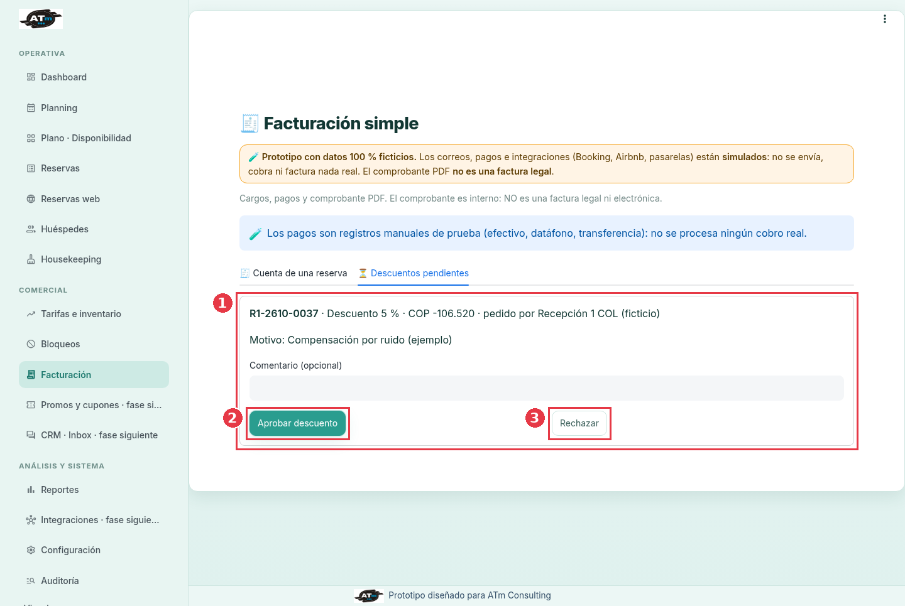

| N.º | Zona | Qué muestra / qué significa |
|---|---|---|
| 1 | Solicitud | Reserva, porcentaje, valor del descuento, quién lo pidió y motivo. Hay un campo de comentario opcional. |
| 2 | «Aprobar descuento» | Aplica el descuento a la cuenta. Solo gerencia, y nunca quien lo pidió: a esa persona le aparece «Tú pediste este descuento: debe aprobarlo otra persona de gerencia». |
| 3 | «Rechazar» | Descarta la solicitud. |

**Mensajes frecuentes:** «El pago (…) es mayor que el saldo pendiente (…).», «El monto del pago debe ser mayor que cero.», «Los descuentos no pueden superar el valor de los cargos.», «La estancia ya terminó (check-out): no se pueden agregar cargos.» y «La reserva está cancelada o fue no-show: no admite más cargos ni pagos.»

### 4.4 Promos y cupones · fase siguiente

**Para qué sirve (cuando se construya):** códigos promocionales, descuentos por estancia y reglas de vigencia sobre las tarifas del PMS.
**Quién la ve:** todos los roles menos Housekeeping, como página informativa.

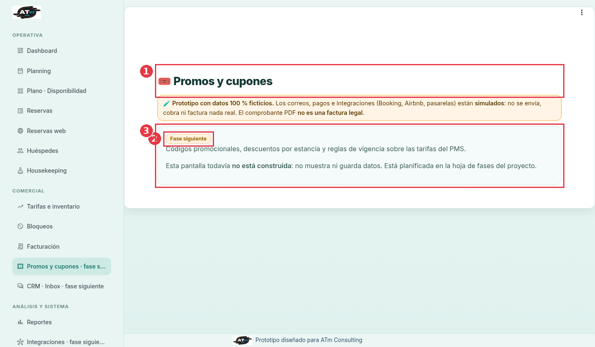

| N.º | Zona | Qué muestra / qué significa |
|---|---|---|
| 1 | Título | «Promos y cupones». |
| 2 | Etiqueta «Fase siguiente» | Indica que la función está planificada. |
| 3 | Descripción | Qué hará la pantalla y el aviso «Esta pantalla todavía **no está construida**: no muestra ni guarda datos. Está planificada en la hoja de fases del proyecto.» |

### 4.5 CRM · Inbox · fase siguiente

**Para qué sirve (cuando se construya):** una bandeja única de mensajes de correo, WhatsApp y OTAs, con un copiloto de IA para responder. Hoy es una página informativa con la misma estructura que Promos: título, etiqueta «Fase siguiente» y descripción. No guarda datos.

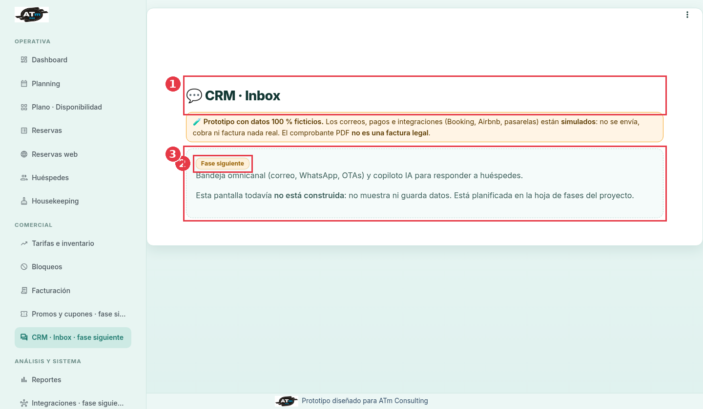

## 5. Análisis y sistema

### 5.1 Reportes

**Para qué sirve:** medir la **ocupación** y los **ingresos** de un período. Las cifras van sin impuestos y en la moneda del hotel.
**Quién la ve:** Gerencia y Administrador.

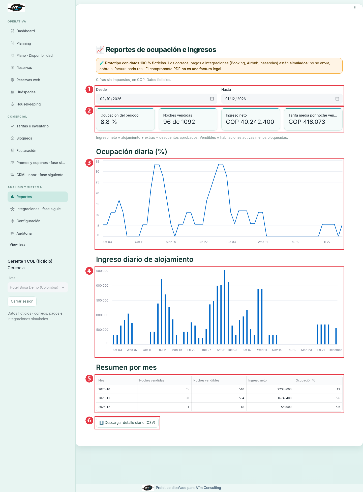

| N.º | Zona | Qué muestra / qué significa |
|---|---|---|
| 1 | Desde y Hasta | Período a analizar. Por defecto va de 30 días atrás a 30 días adelante. Máximo 400 días. |
| 2 | Indicadores | **Ocupación del período** (%), **Noches vendidas** («X de Y» vendibles), **Ingreso neto** y **Tarifa media por noche vendida**. Debajo: «Ingreso neto = alojamiento + extras − descuentos aprobados. Vendibles = habitaciones activas menos bloqueadas.» |
| 3 | Ocupación diaria (%) | Gráfico de línea: cada punto es un día. Al pasar el ratón se ve el valor exacto. |
| 4 | Ingreso diario de alojamiento | Gráfico de barras: lo vendido en noches cada día. |
| 5 | Resumen por mes | Tabla con Mes, Noches vendidas, Noches vendibles, Ingreso neto y Ocupación %. |
| 6 | «⬇️ Descargar detalle diario (CSV)» | Archivo para Excel con Fecha, Vendibles, Vendidas, Ocupación %, Alojamiento, Extras, Descuentos e Ingreso neto. |

**Mensajes frecuentes:** «La fecha final debe ser igual o posterior a la inicial.» y «Elige un rango de máximo 400 días.»

### 5.2 Integraciones · fase siguiente

**Para qué sirve (cuando se construya):** conectar un channel manager (Booking, Airbnb, Expedia), una pasarela de pago real (Wompi en Colombia; Azul o CardNET en República Dominicana) y el envío real de correos transaccionales. Hoy es una **página informativa**: título, etiqueta «Fase siguiente» y descripción. No muestra ni guarda datos.

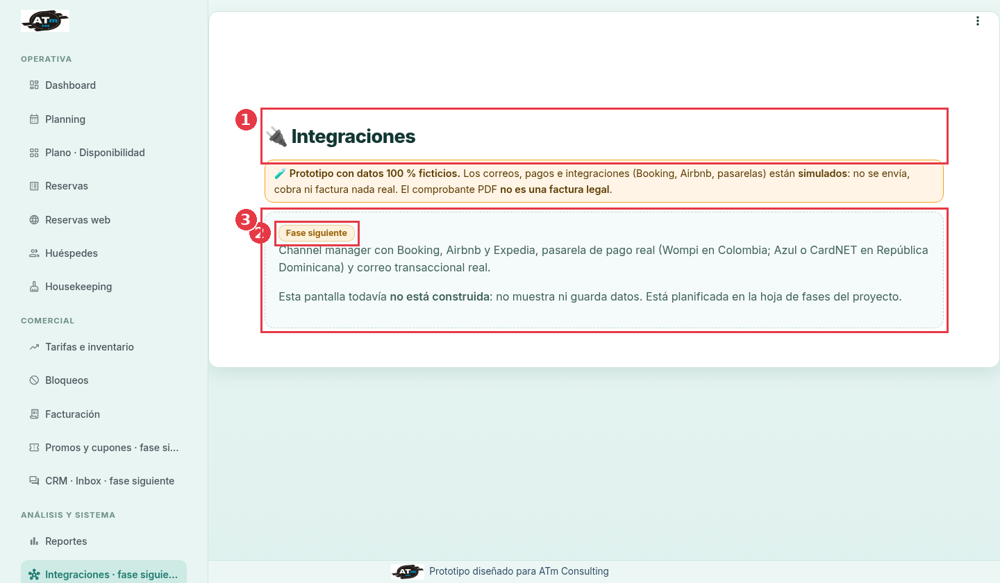

### 5.3 Configuración

**Para qué sirve:** dar de alta y mantener **hoteles, impuestos, tipos de habitación, habitaciones con sus camas y usuarios**.
**Quién la ve:** el Administrador edita. Gerencia solo consulta («Tu rol solo puede consultar la configuración. Los cambios los hace un administrador.»).

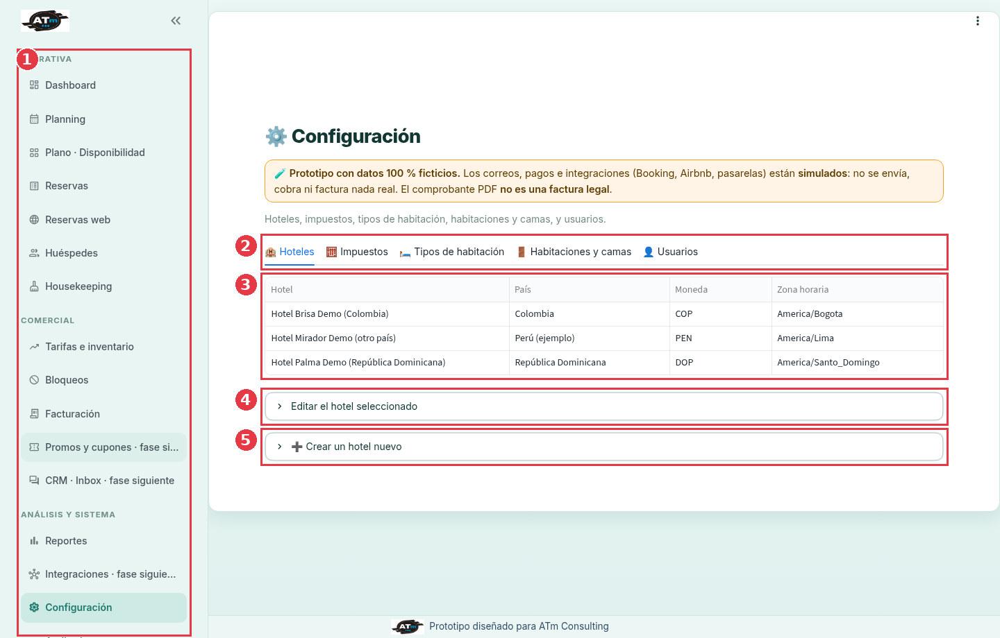

| N.º | Zona | Qué muestra / qué significa |
|---|---|---|
| 1 | Menú del administrador | El administrador ve todas las secciones. Arriba en la barra lateral elige el **hotel** con el que trabaja (si tiene acceso a varios). |
| 2 | Pestañas | 🏨 Hoteles · 🧮 Impuestos · 🛏️ Tipos de habitación · 🚪 Habitaciones y camas · 👤 Usuarios. |
| 3 | Tabla de hoteles | Nombre, País, Moneda y Zona horaria de cada hotel. En la demo hay tres hoteles ficticios: Colombia, Perú y República Dominicana. |
| 4 | Editar el hotel seleccionado | Nombre, País, **Moneda (3 letras)**, **Zona horaria** y **Guardar hotel**. |
| 5 | ➕ Crear un hotel nuevo | Los mismos campos y el botón **Crear hotel** (solo el administrador con acceso a todos los hoteles). |

**🧮 Impuestos:** tabla Impuesto, Porcentaje y Activo; se agrega o actualiza con **Nombre del impuesto**, **Porcentaje**, **Activo** y **Guardar**. Cada hotel define los suyos. Un cambio **solo afecta reservas nuevas**; las existentes conservan los impuestos con que se crearon.
**🛏️ Tipos de habitación:** tabla Tipo, Capacidad y Descripción; se agrega con **Nombre del tipo**, **Capacidad**, **Descripción** y **Crear tipo**.

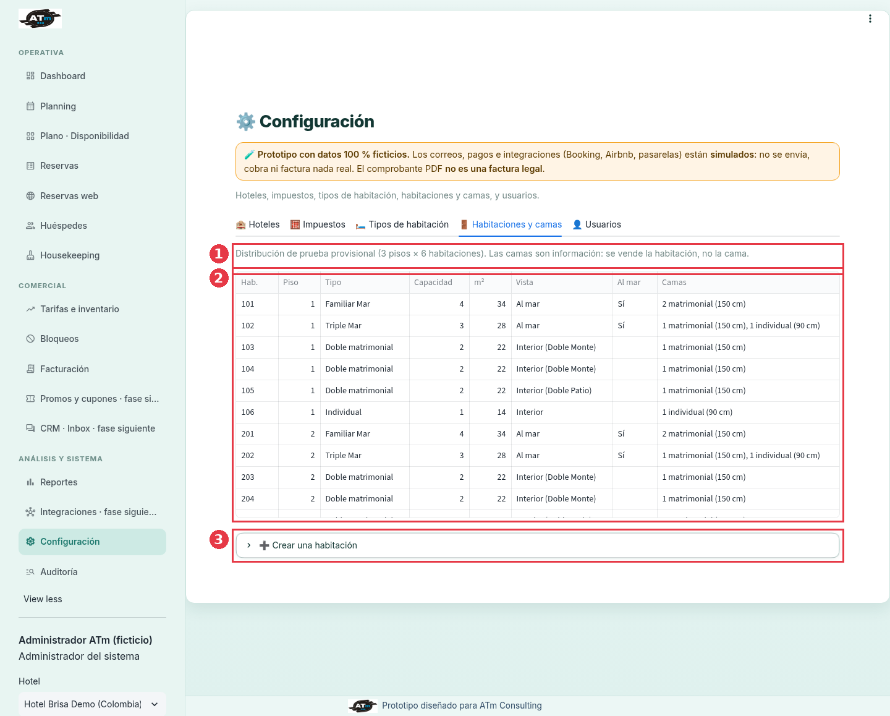

| N.º | Zona | Qué muestra / qué significa |
|---|---|---|
| 1 | Nota | «Distribución de prueba provisional (3 pisos × 6 habitaciones). Las camas son información: se vende la habitación, no la cama.» |
| 2 | Tabla de habitaciones | **Hab.**, **Piso**, **Tipo**, **Capacidad**, **m²**, **Vista**, **Al mar** y **Camas** (por ejemplo «1 matrimonial (140 cm)»). |
| 3 | ➕ Crear una habitación | **Número**, **Piso**, **Tipo**, **Metros cuadrados**, **Vista**, la casilla **Vista al mar** (aparece en el filtro del Plano), **Tipo de cama**, **Ancho (cm)**, **Cantidad** y **Crear habitación**. |

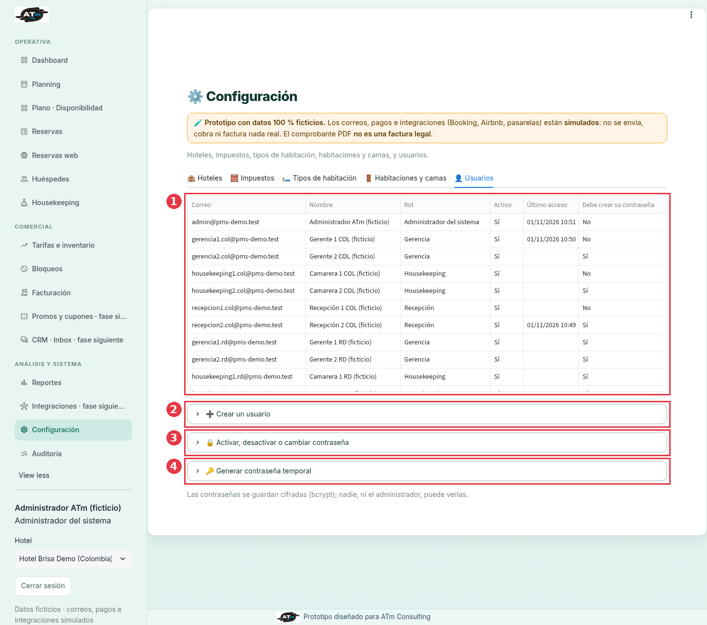

| N.º | Zona | Qué muestra / qué significa |
|---|---|---|
| 1 | Tabla de usuarios | **Correo**, **Nombre**, **Rol**, **Activo**, **Último acceso** y **Debe crear su contraseña** (Sí = aún no entró por primera vez o se le asignó una clave nueva). Las contraseñas **nunca** se muestran: se guardan cifradas (bcrypt). |
| 2 | ➕ Crear un usuario | Correo, Nombre, **Rol** (Recepción, Gerencia, Housekeeping o Administrador), **Contraseña inicial (mínimo 8 caracteres)**, la casilla **Acceso a todos los hoteles (solo administrador)** y **Crear usuario**. |
| 3 | 🔒 Activar, desactivar o cambiar contraseña | Elige el usuario y pulsa **Desactivar** o **Activar**, o escribe una **Nueva contraseña** y pulsa **Cambiar contraseña**. Se cierran sus sesiones y la persona deberá crear la suya al entrar. |
| 4 | 🔑 Generar contraseña temporal | Crea una clave aleatoria que se muestra **una sola vez** («Contraseña temporal de …: cópiala ahora, no se volverá a mostrar.»). Debe entregarse por un canal privado. |

**Mensajes frecuentes:** «Ya existe un usuario con ese correo.», «La contraseña debe tener al menos 8 caracteres.», «Este rol necesita un hotel asignado.», «No generes una contraseña temporal para ti mismo: usa «Cambiar contraseña».», «Ya existe la habitación N.», «Ya existe un tipo con ese nombre.», «La capacidad debe ser al menos 1 persona.», «La moneda debe ser un código de 3 letras (por ejemplo COP, DOP, USD).» y «Zona horaria no válida (ejemplo: America/Bogota).»

### 5.4 Auditoría

**Para qué sirve:** consultar el **registro de cambios importantes**: quién hizo qué, cuándo y qué había antes. Solo se agrega: **nadie puede editarlo ni borrarlo**.
**Quién la ve:** Gerencia y Administrador (solo consulta).

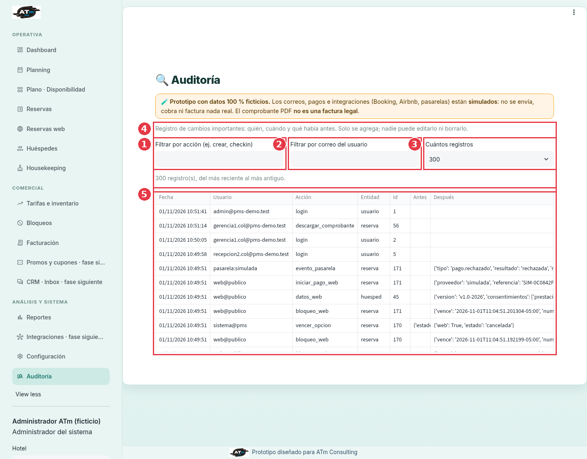

| N.º | Zona | Qué muestra / qué significa |
|---|---|---|
| 1 | Filtrar por acción | Por ejemplo «crear», «checkin», «login» o «bloqueo_web». |
| 2 | Filtrar por correo del usuario | Muestra solo lo que hizo una persona. |
| 3 | Cuántos registros | 100, 300 (por defecto) o 1000. |
| 4 | Conteo | «N registro(s), del más reciente al más antiguo.» |
| 5 | Tabla | **Fecha** (con segundos), **Usuario**, **Acción**, **Entidad** (reserva, huésped, usuario…), **Id**, **Antes** y **Después** (resumen de los datos que cambiaron). |

**Uso típico:** para saber quién canceló una reserva, escribe «cancel» en Acción y busca el código de la reserva en la columna Después.

## 6. Mini web de reservas (pública)

**Para qué sirve:** que un cliente reserve desde la página del hotel sin llamar. Aparta (bloquea) la habitación **15 minutos**, paga en una **pasarela simulada** y recibe un **número de reserva** con un **correo simulado**. Todo lo que reserva aparece al instante en el PMS (Reservas web, Reservas, Planning y Plano) con canal «web».
**Quién la ve:** cualquier persona, sin usuario ni contraseña: https://pms-reservas-atm.streamlit.app/. Siempre muestra el aviso «Prototipo con datos ficticios. No se cobra dinero ni se hace una reserva real: el pago y el correo son simulados.»

### 6.1 Paso 1 · Buscar y elegir habitación

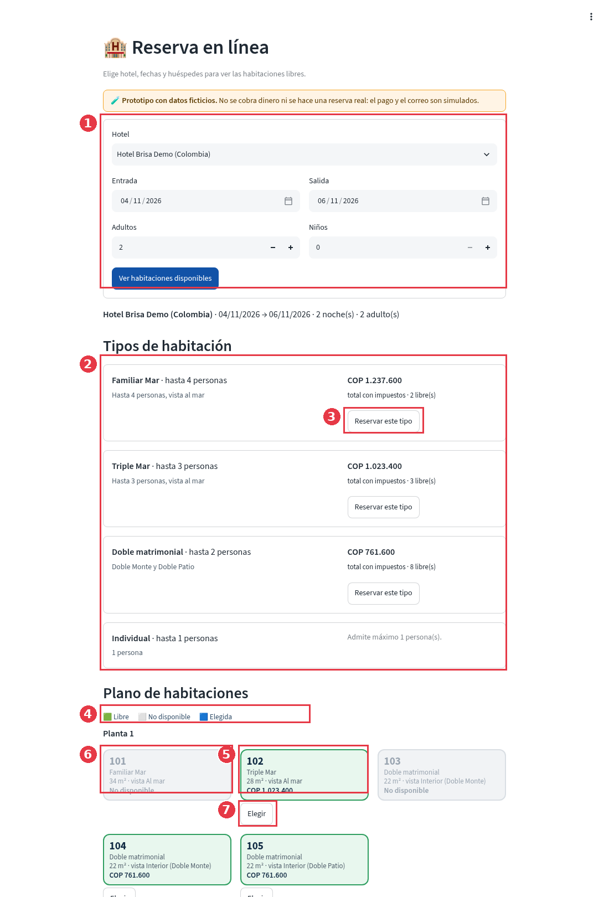

| N.º | Zona | Qué muestra / qué significa |
|---|---|---|
| 1 | Búsqueda | Hotel, Entrada, Salida, Adultos y Niños. |
| 2 | Tipos disponibles | Una tarjeta por tipo de habitación con capacidad, camas, **precio total con impuestos** y cuántas quedan libres. |
| 3 | «Reservar este tipo» | El sistema asigna una habitación libre de ese tipo. |
| 4 | Leyenda | Libre, No disponible y 🌊 Vista al mar. |
| 5 | Habitación libre | Tarjeta verde con número, tipo y camas. |
| 6 | Habitación no disponible | Tarjeta gris: ocupada, bloqueada o de otro tamaño. No muestra datos de otros huéspedes. |
| 7 | «Elegir» | Escoge esa habitación concreta del plano. |

Al elegir aparece el cuadro **«Tu elección»** con el resumen y una **verificación anti-robots** («Verificación anti-robots: ¿cuánto es 4 + 7?»; los números cambian cada vez). Al pulsar **«Bloquear mi habitación»** se aparta por 15 minutos. Con **«Cambiar elección»** se vuelve atrás.

### 6.2 Paso 2 · Tus datos (con temporizador)

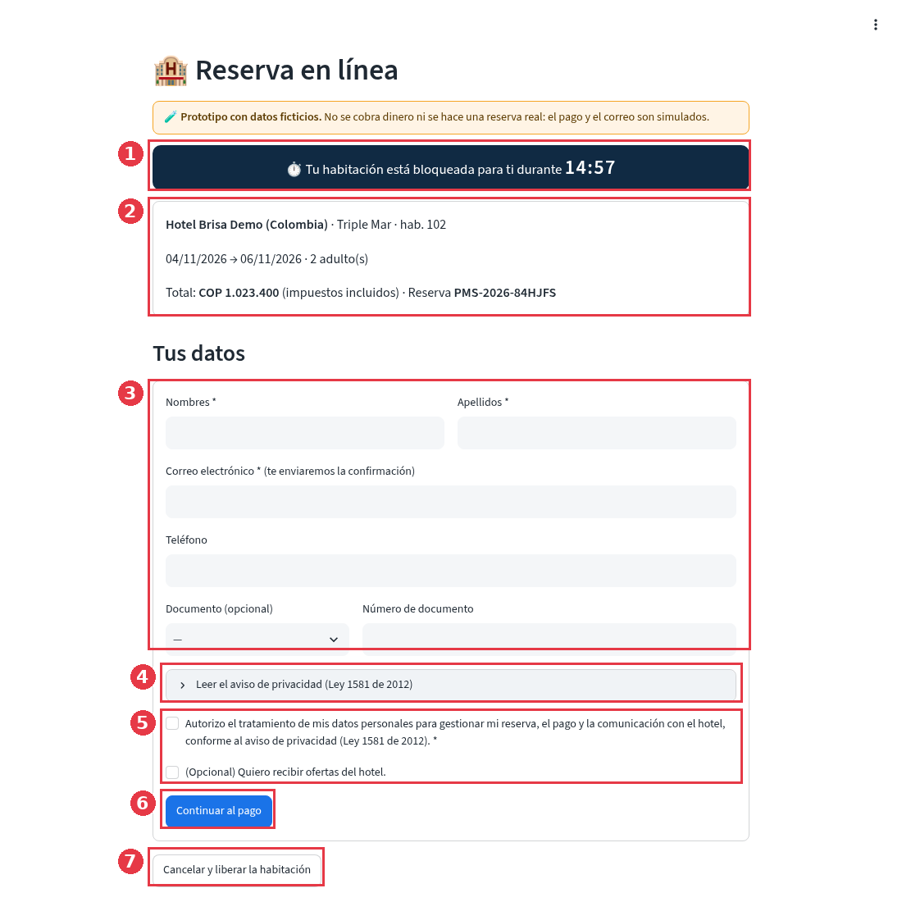

| N.º | Zona | Qué muestra / qué significa |
|---|---|---|
| 1 | Temporizador | «Tu habitación está bloqueada para ti durante mm:ss». Cuenta hacia atrás. |
| 2 | Resumen | Hotel, tipo y habitación, fechas, noches, personas, **total con impuestos** y número de reserva. |
| 3 | Datos del cliente | Nombres*, Apellidos*, Correo electrónico* (allí llega la confirmación), Teléfono y documento (opcional). |
| 4 | Aviso de privacidad | Desplegable con el texto legal (Ley 1581 de 2012). |
| 5 | Consentimientos | Uno **obligatorio** (tratamiento de datos para gestionar la reserva) y uno **opcional** (recibir ofertas). |
| 6 | «Continuar al pago» | Guarda los datos y pasa a la pasarela. |
| 7 | «Cancelar y liberar la habitación» | Suelta el bloqueo de inmediato. |

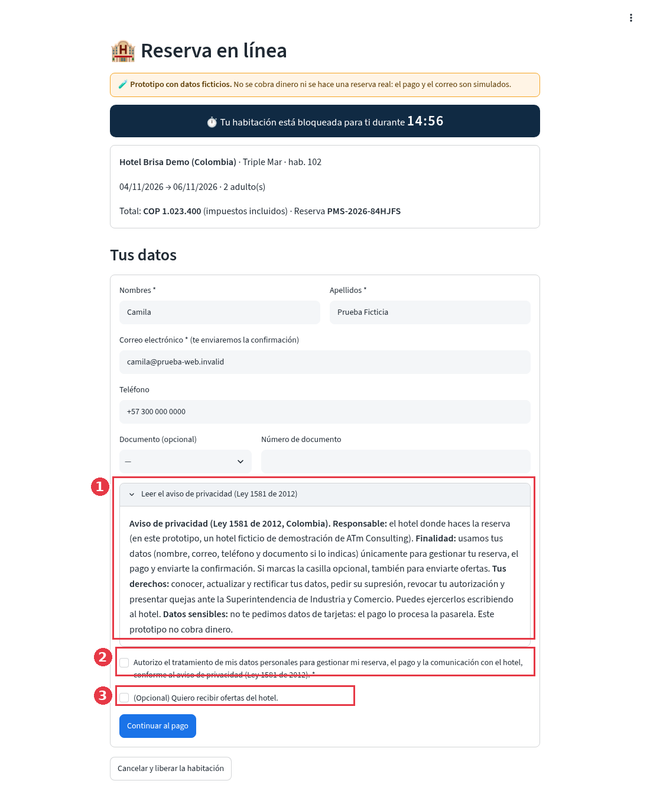

| N.º | Zona | Qué muestra / qué significa |
|---|---|---|
| 1 | Aviso abierto | Responsable, finalidad, derechos del titular (conocer, actualizar, rectificar, suprimir, revocar) y cómo ejercerlos. |
| 2 | Consentimiento obligatorio | Sin marcarlo no se puede continuar. |
| 3 | Consentimiento opcional | Ofertas del hotel; queda como finalidad «Comunicaciones comerciales» en la ficha del huésped. |

### 6.3 Paso 3 · Pasarela de pagos (simulada)

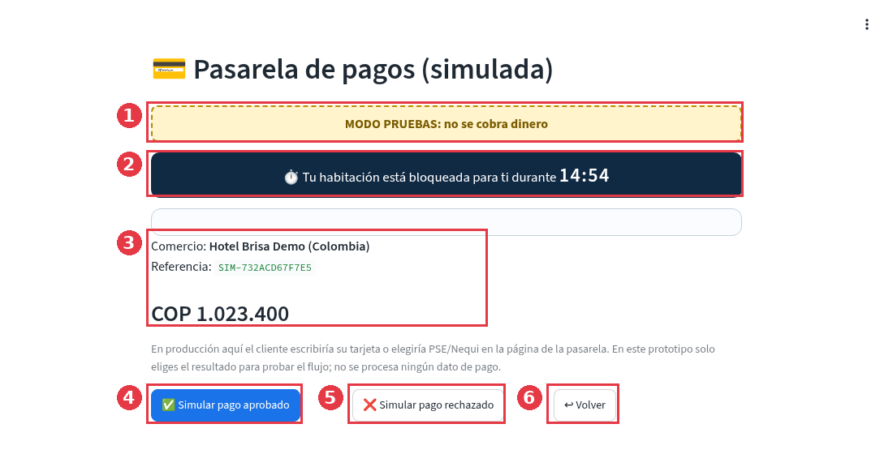

| N.º | Zona | Qué muestra / qué significa |
|---|---|---|
| 1 | «MODO PRUEBAS: no se cobra dinero» | Recuerda que no hay cobro real. |
| 2 | Temporizador | El bloqueo sigue corriendo durante el pago. |
| 3 | Comercio, referencia y monto | Datos del cobro que vería una pasarela real. |
| 4 | «✅ Simular pago aprobado» | Confirma la reserva. |
| 5 | «❌ Simular pago rechazado» | Muestra el rechazo; mientras el bloqueo siga vigente se puede **reintentar** («Pagar $X») o **Editar mis datos**. |
| 6 | «↩ Volver» | Regresa a los datos sin pagar. |

### 6.4 Paso 4 · Confirmación y correo

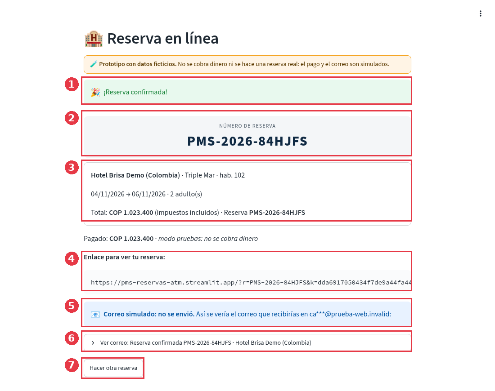

| N.º | Zona | Qué muestra / qué significa |
|---|---|---|
| 1 | «🎉 ¡Reserva confirmada!» | El pago fue aprobado y la reserva quedó **confirmada** en el PMS. |
| 2 | Número de reserva | Formato PMS-AAAA-XXXXXX. Es lo que el cliente cita al llegar. |
| 3 | Resumen | Hotel, habitación, fechas, personas, total y «Pagado … modo pruebas». |
| 4 | Enlace para ver tu reserva | Dirección privada para volver a consultar la reserva. |
| 5 | Aviso de correo simulado | El correo **no se envía**: se muestra cómo lo recibiría el cliente (con el correo parcialmente oculto). |
| 6 | «Ver correo» | Abre la vista previa del correo. |
| 7 | «Hacer otra reserva» | Vuelve al inicio. |

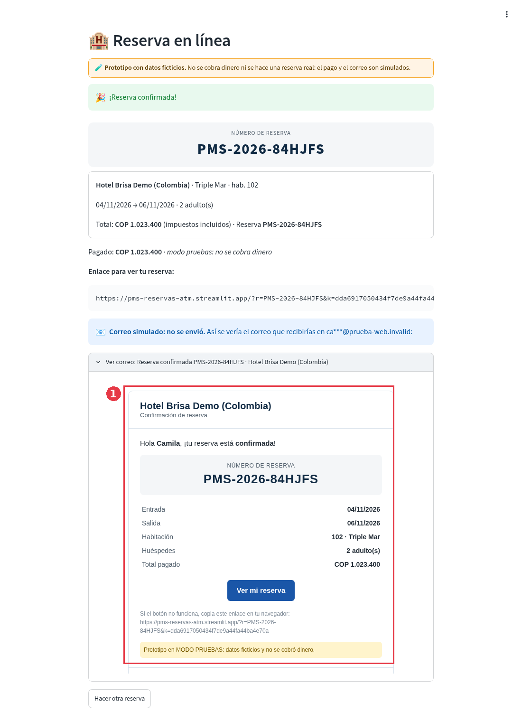

| N.º | Zona | Qué muestra / qué significa |
|---|---|---|
| 1 | Correo de confirmación | Hotel, saludo, número de reserva destacado, entrada, salida, habitación, huéspedes, total pagado, botón **Ver mi reserva** y la nota de modo pruebas. |

### 6.5 Mensajes frecuentes de la mini web

| Mensaje | Qué hacer |
|---|---|
| «⌛ El bloqueo de esta reserva venció.» | Pasaron los 15 minutos sin pagar. Pulsa **«Buscar otra habitación»**. |
| «Tu bloqueo venció o ya no está activo. Vuelve a elegir tu habitación.» | Igual que el anterior. |
| «Ya no hay habitaciones libres de ese tipo en esas fechas.» | Otra persona la tomó; elige otro tipo o fechas. |
| «La verificación no es correcta.» | Revisa la suma anti-robots. |
| «Debes autorizar el tratamiento de tus datos personales (Ley 1581 de 2012) para continuar.» | Marca el consentimiento obligatorio. |
| «Máximo N noches por reserva web.» | Reserva menos noches o contacta al hotel. |
| «Ese correo ya tiene bloqueos activos…» / «Has hecho demasiados bloqueos seguidos…» | Protección contra abusos: termina o cancela el bloqueo anterior y espera unos minutos. |

## 7. Glosario rápido

| Término | Significado |
|---|---|
| Bloqueo web | Habitación apartada 15 minutos mientras el cliente paga en la mini web. |
| Bloqueo (Comercial) | Habitación fuera de venta unas noches por mantenimiento u otro motivo. |
| Opción | Reserva provisional que vence sola si no se confirma. |
| No-show | El huésped no llegó en su fecha de entrada. |
| Precio congelado | Las noches de una reserva guardan el precio del día en que se creó. |
| Fase siguiente | Pantalla planificada: hoy solo describe lo que hará. |
| Channel manager | Sistema que sincroniza la disponibilidad con Booking, Airbnb, Expedia, etc. |
| Auditoría | Registro que no se puede borrar de quién cambió qué y cuándo. |

> Manual elaborado a partir del código de la Suite v2 y de capturas tomadas con una base de datos local de pruebas, con datos ficticios. Prototipo diseñado para ATm Consulting.
