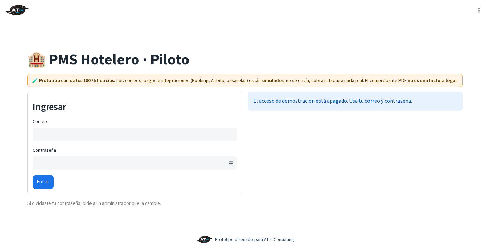
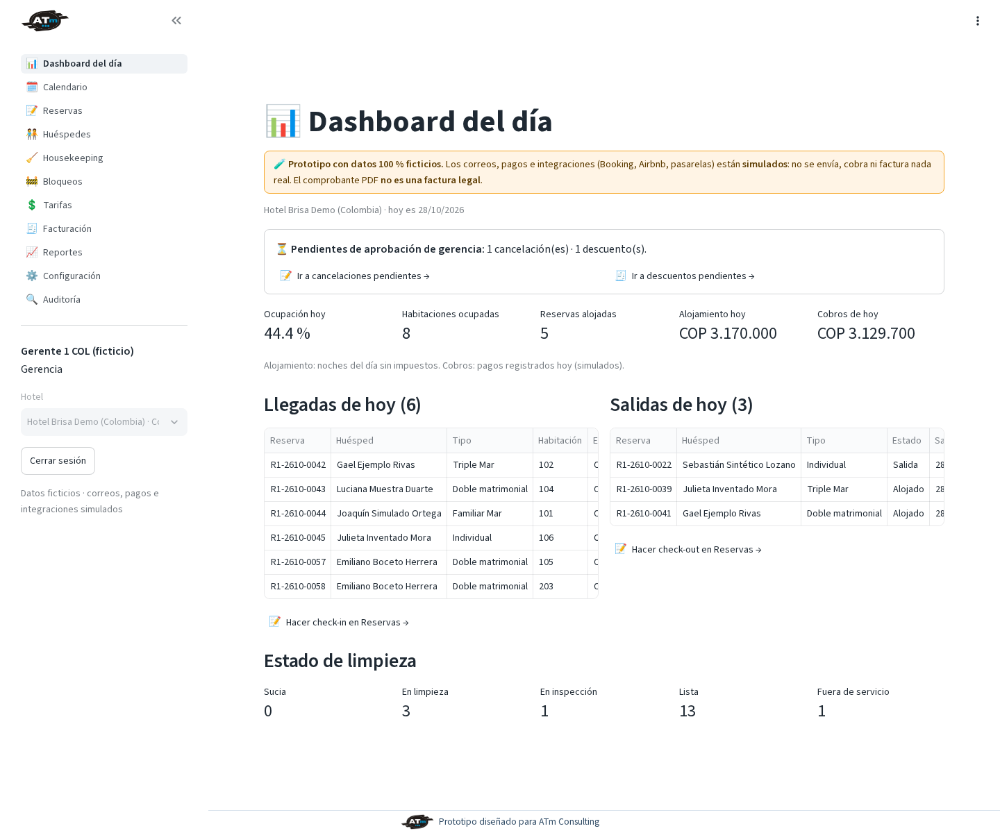
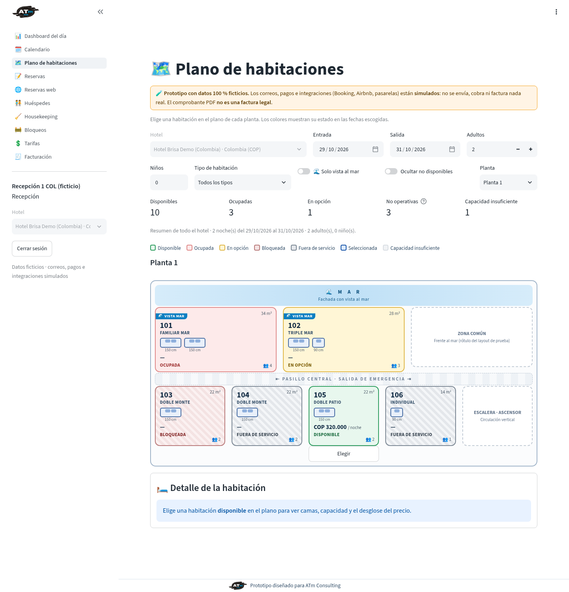
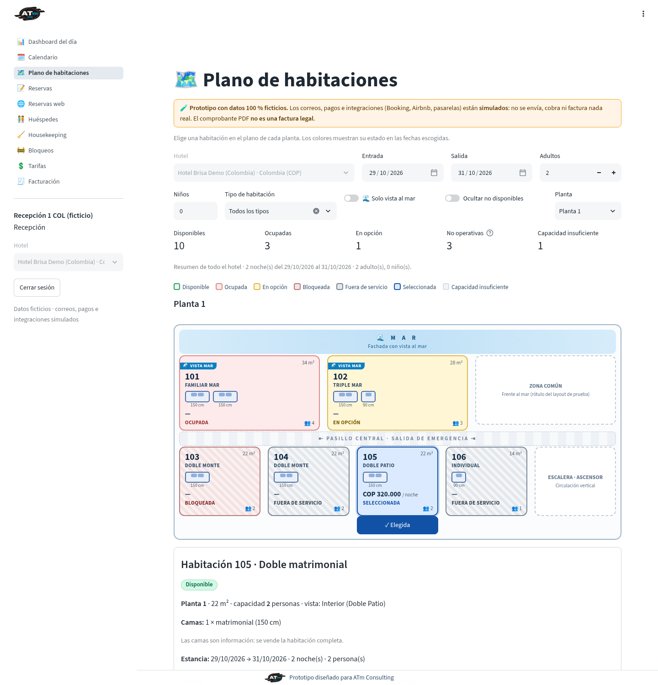
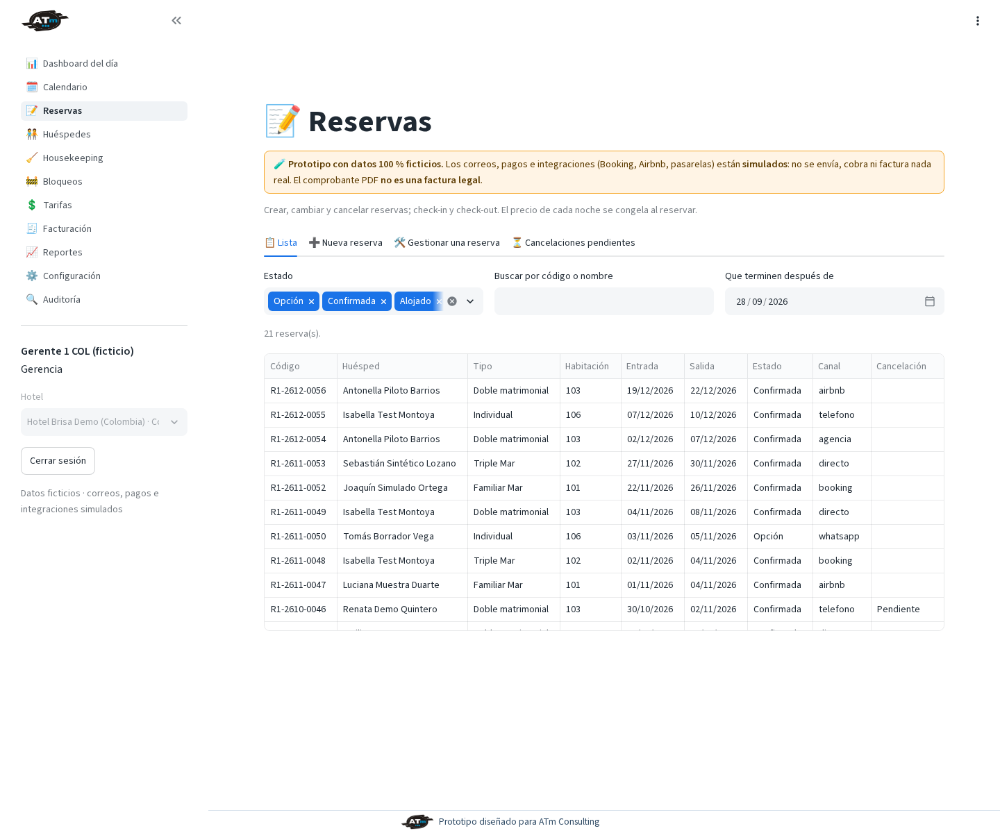
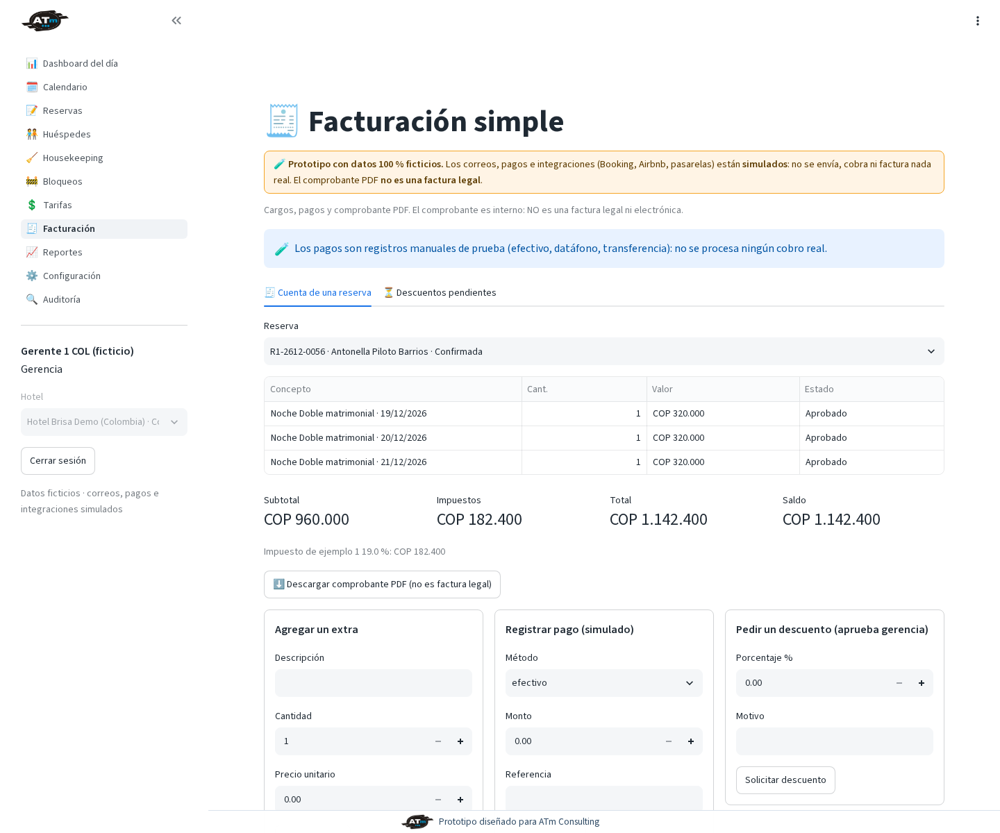
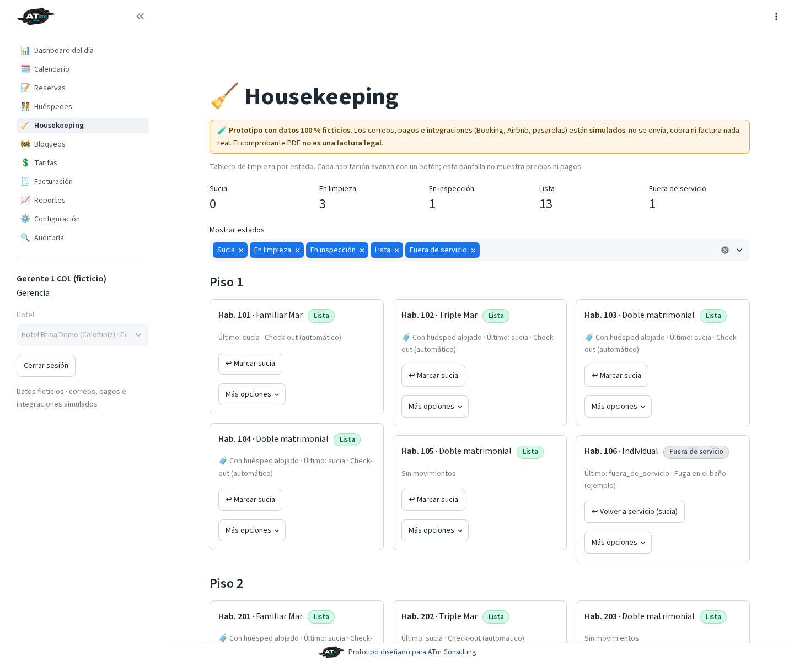
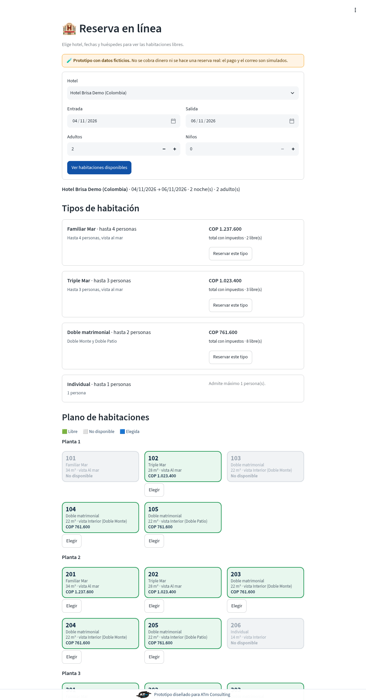
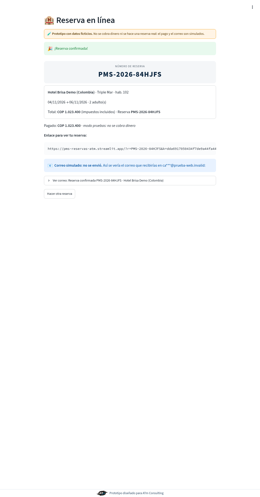

# PMS Hotelero · Piloto — Manual de uso

*Prototipo diseñado para ATm Consulting · versión 1.0 · 29 de octubre de 2026 · todos los datos son ficticios*

## 1. Antes de empezar
### 1.1 Abrir la app
- Personal del hotel: **https://pms-hoteles-atm.streamlit.app/**
- Clientes (reserva en línea): **https://pms-reservas-atm.streamlit.app/**

Si la app «está dormida» (plan gratuito), pulse el botón para despertarla y espere un minuto.

### 1.2 Usuarios de prueba
Hay 19 usuarios ficticios (administrador, y recepción, gerencia y housekeeping por hotel). Los correos y las contraseñas temporales están en el archivo **«PMS - Usuarios de prueba y contraseñas temporales.txt»** de la carpeta del proyecto en Drive. Este manual no contiene contraseñas.

### 1.3 Primer ingreso
1. Escriba su correo y la contraseña temporal y pulse **Entrar**.
2. La app muestra **«Crea tu contraseña nueva»**: mínimo 10 caracteres, repetida dos veces y distinta de la temporal. Hasta guardarla no verá nada más.
3. Para salir, pulse **Cerrar sesión** en la barra lateral. Tras 5 intentos fallidos en 15 minutos el ingreso se bloquea temporalmente.

## 2. Recepción
### 2.1 Dashboard del día
Llegadas, salidas y estado de limpieza de hoy para su hotel.

### 2.2 Plano de habitaciones
1. Abra **Plano de habitaciones**, elija planta, fechas de entrada y salida, adultos y niños.
2. Filtre por tipo, **solo vista al mar** u **ocultar no disponibles**.
3. Los colores indican: disponible, ocupada, en opción, bloqueada, fuera de servicio, seleccionada; las que no tienen capacidad suficiente salen en gris.
4. Pulse **Elegir** en una habitación para ver camas, capacidad y desglose de precio.
5. Pulse **Continuar con la reserva →**: se abre Reservas con hotel, fechas, personas y habitación ya rellenados.

> El plano está siendo redibujado como plano de planta (franja del mar, camas dibujadas y rótulo «vista al mar»). Las capturas muestran la versión publicada al generar este manual.

### 2.3 Nueva reserva
En **Reservas → Nueva reserva**: 1) huésped (buscar o crear, con autorización de datos Ley 1581), 2) estancia (fechas, personas, tipo, habitación opcional, estado consulta/opción/confirmada, canal), 3) revisar el desglose por noche con impuestos y pulsar **Guardar reserva**. Una opción vence en 48 horas si no se confirma.

### 2.4 Gestionar una reserva
En **Gestionar una reserva** puede modificar fechas o personas, **Cambiar habitación**, **Hacer check-in**, **Hacer check-out**, **Solicitar cancelación** (la aprueba gerencia), **Marcar no-show** y **Simular envío de confirmación**.

### 2.5 Calendario y huéspedes
**Calendario**: ocupación por habitación y noche. **Huéspedes**: buscar, ver ficha, registrar o revocar consentimientos.

### 2.6 Facturación
En **Facturación → Cuenta de una reserva**: **Agregar extra**, **Registrar pago**, **Solicitar descuento** (lo aprueba gerencia), anular extras o pagos y descargar el comprobante PDF (no es factura legal).

## 3. Gerencia
Todo lo de recepción, más:
- **Reservas → Cancelaciones pendientes** y **Facturación → Descuentos pendientes**: aprobar o rechazar (nunca las propias).
- **Tarifas**: crear y editar tarifas por tipo y temporada, estancia mínima y cierre de ventas.
- **Bloqueos**: crear y liberar bloqueos por mantenimiento.
- **Reportes**: ocupación diaria, ingreso diario y resumen por mes.
- **Forzar salida con saldo** en el check-out.
- Consulta Configuración y Auditoría.

## 4. Housekeeping
En **Housekeeping** vea las habitaciones de su hotel y cambie el estado: sucia → en limpieza → inspección → lista, o fuera de servicio. Solo se permiten los pasos válidos. Puede consultar Bloqueos.

## 5. Administrador
- **Configuración**: hoteles (país, moneda, zona horaria), impuestos genéricos (nombre y %), tipos de habitación, habitaciones (planta, metros, vista, casilla **vista al mar**, camas) y usuarios.
- **Usuarios → Generar contraseña temporal**: se muestra una sola vez; la persona deberá crear la suya al entrar.
- Bloqueos, tarifas y reportes; consulta del resto y de la **Auditoría** (no se puede editar ni borrar).

## 6. Reservas web
### 6.1 Cliente
1. Abra la mini web, elija hotel, fechas y huéspedes.
2. Elija una habitación del plano: queda **bloqueada 15 minutos** (se ve el reloj).
3. Escriba sus datos y marque la autorización de datos.
4. Pague en la **pasarela simulada** (modo de pruebas, no cobra).
5. Recibe el número **PMS-AAAA-XXXXXX** y el correo de confirmación (simulado, se muestra en pantalla).

### 6.2 Personal
La página **Reservas web** lista estas reservas y su estado; también aparecen en Reservas, Calendario y Plano con canal `web`.

## 7. Preguntas frecuentes
- **¿Puedo vender dos veces la misma habitación?** No; la base de datos lo impide.
- **¿Cambia el precio si cambio la tarifa después?** No; el precio de cada noche queda congelado al vender.
- **¿Por qué no veo una página?** Su rol no tiene acceso (ver la tabla de permisos en las Especificaciones técnicas).
- **¿Se cobran pagos o se envían correos reales?** No en el piloto; todo está simulado y rotulado.

## 8. Solución de problemas
| Síntoma | Qué hacer |
|---|---|
| La app está dormida | Pulse el botón para despertarla y espere |
| «Usuario bloqueado» | Espere 15 minutos o pida al administrador una contraseña temporal |
| Olvidé mi contraseña | El administrador genera una temporal en Configuración → Usuarios |
| «Error inesperado» | Recargue la página; si sigue, avise a soporte con la hora |
| No aparece una habitación en el plano | Revise filtros «ocultar no disponibles», tipo y capacidad |
